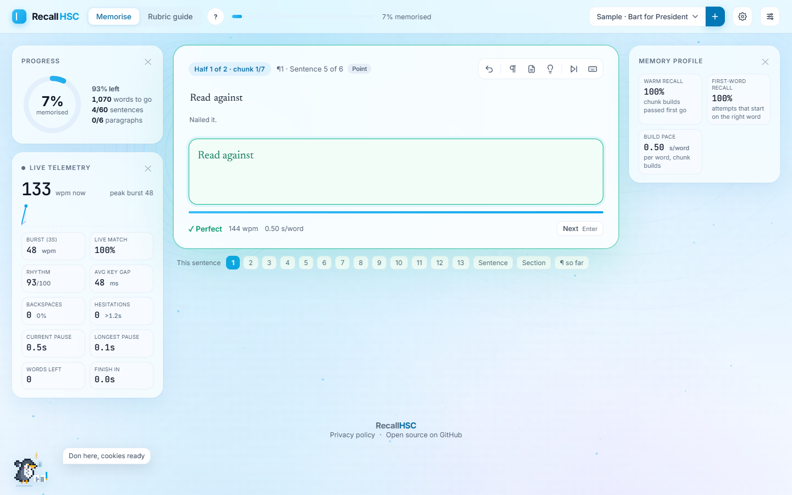

<div align="center">

# Recall<sub><sup>HSC</sup></sub>

**Memorise HSC English essays, chunk by chunk.**

Type it, recall it, own it, in the browser, offline, for free.

[](https://timliniscool.github.io/recallhsc/)
[](https://timliniscool.github.io/recallhsc/beta/)


**[How it works under the hood →](TECHNICAL.md)** · architecture, algorithms, marking and the handwriting AI



</div>

---

## Why RecallHSC

Memorising a 1,000-word essay by rereading it doesn't stick. RecallHSC builds it the way memory actually works: **small pieces, recalled from memory, then joined into bigger ones**, with honest marking every step of the way.

| | |
|---|---|
| 🧩 **Chunk drills** | Each sentence is built up a few meaningful words at a time. Long sentences are learnt in two halves first. |
| 🪜 **A recall ladder** | Chunk → sentence → IQTVE / quote + analysis unit → paragraph (twice at the end) → the whole essay so far at checkpoints. |
| ✍️ **Any kind of writing** | Essays, creative, discursive and hybrid pieces. Structure, moves (narrative, reflection, question, turn) and recurring motifs are found automatically. |
| ✅ **Marking you can trust** | Standard (spelling-tolerant, the default), Exact words, Strict quotes or Verbatim. Every check shows exactly what you missed. |
| 📈 **See it working** | Live typing telemetry, a memory profile (your nemesis word, signature typo, slip point) and progress by word, sentence and paragraph. |
| 📚 **Rubric guide** | NESA rubrics, trial-question stats, exam tips, Module C exemplars and a writing booklet, built in. |
| 🎮 **Game mode** | A retro platformer that runs on your recall, with a handheld-console layout on phones. And Don the falcon. |

## Built for real study sessions

- **Works offline.** After the first visit it runs without a connection, and installs like an app (Settings → App).
- **Updates itself.** Open the site and you're on the latest version. If an update lands while you're mid-answer, it waits for you to tap Update.
- **Optional cloud sync.** Sign in with an email link to carry essays and progress across devices. Everything works without an account.
- **Accessible.** Fully keyboard-operable, screen-reader announcements, accessible dialogs, reduced motion, high contrast, a standard text box mode and adjustable text size.
- **Private by default.** Essays stay in your browser. No cookies, no ads. Anonymous usage counts can be switched off. See the [privacy policy](https://timliniscool.github.io/recallhsc/privacy.html).

## ✍️ iPad beta: write it by hand

HSC exams are handwritten, so the [beta](https://timliniscool.github.io/recallhsc/beta/) lets you practise by hand with **Apple Pencil** (iPad only).

- Endless lined or blank paper with an exam-style margin; Apple Pencil writes, fingers scroll, palms are ignored.
- Press **Check** and your writing is read **on the iPad itself** (TrOCR-small via transformers.js + ONNX Runtime Web). It's free and private, and works offline after a one-time download.
- It's fast because it already knows what you meant to write: finished lines are prepared while you write, and messy-but-right words get the benefit of the doubt, while genuinely wrong words still fail.

## Every feature

<details open>
<summary><b>Learning an essay</b></summary>

- **Chunk drills:** each sentence is built from meaning-based chunks, one chunk added at a time. You choose the maximum chunk size (2–7 words).
- **Long sentences in halves:** long sentences are learnt as two halves, split at natural breaks, then recalled whole.
- **A recall ladder:** chunk → whole sentence → IQTVE / quote + analysis unit → paragraph so far → full paragraph (twice at the end of each paragraph) → the whole essay so far at checkpoints.
- **Essay checkpoints:** whole-essay recalls at natural points (can be turned off in Settings).
- **Choose where the essay starts:** start from any sentence. Say "I already know it" (everything before counts as learnt) or "I'll come back to it later".
- **Sentence map:** every sentence as a dot (learnt, current, topic sentence, end of a unit). Tap one to go straight there and relearn it.
- **Step strip:** the steps for the current sentence (each chunk, Sentence, Section, ¶ so far, Essay) as buttons you can jump between.
- **Back one step** (Ctrl Z on an empty box), **Skip** (Tab), **Retry** and **Again** at every step.
- **Next-word hint** (Ctrl H): it knows which word you're really up to, even if you skipped one, and tells you what you missed.
- **Peek:** hold to see the paragraph so far (Ctrl P) or the whole essay (Ctrl O); the whole essay is always shown, with what's ahead softened.
- **Hide the prompt as I type:** the chunk you're copying fades once you start.
- **Tap-to-pick words:** choose the next word from three instead of typing (on by default on phones), with Undo word and Type instead.
- **Typing ahead:** answers are checked automatically once you reach the end.
- **Progress that never gets lost:** partial credit for chunks already built, saved after every step, repaired on load, and kept in step across open tabs.
- **Clear delay:** how long a passed chunk's marking stays before moving on (0.5–4 s).
- **Reset progress** for one essay without touching its text.

</details>

<details open>
<summary><b>Your essays</b></summary>

- **Upload, paste or drag in** essays, creative, discursive and hybrid pieces. A sample essay ("Bart for President") is included to try.
- **Writing type detected automatically:** formulaic essays (IQTVE, QTVE…), your own structure, creative, discursive or hybrid. Roles (topic sentence, quote, analysis, link), moves (narrative, reflection, question, turn) and recurring motifs are found for you.
- **Discursive motif drills:** when a phrase echoes an earlier paragraph, you recall where it first came up.
- **Essay switcher** with live % memorised for every essay (Alt 1–9 to switch).
- **Manage essays:** rename, edit the text, delete (with confirmation); progress follows the essay.
- **Back up and restore** everything to a file, with or without your settings.

</details>

<details open>
<summary><b>Marking</b></summary>

- **Four marking modes:** Standard (spelling tolerant, the default), Exact words, Strict quotes (quotes word-perfect on top of the pass mark) and Verbatim (wording, capitals and punctuation all count).
- **Adjustable pass mark** (60–100%).
- **Every check shows the marking:** missed, wrong and extra words highlighted, the first slip, and a plain-English summary.
- **Never stutters:** marking runs in a background worker, even on long essays.

</details>

<details open>
<summary><b>Statistics</b></summary>

- **Progress:** % memorised by words, words to go, sentences and paragraphs learnt, shown in the top bar too.
- **Live telemetry:** wpm now, 3-second burst, live match, rhythm, average key gap, backspaces, hesitations, current and longest pause, words left, and an estimated finish time.
- **Memory profile:** nemesis word, signature typo, hardest sentence, slip point, cold and warm recall, first-word recall, memorise rate, sharpest hour of the day, build and recall pace, retries.
- **Deep stats:** per-mode tallies (stricter modes are never averaged in with Standard) and history.
- **Panels** can be shown or hidden one by one, and **Focus mode** hides them all, with a pearlescent "Locked in" ripple.

</details>

<details open>
<summary><b>Rubric guide</b></summary>

- Common Module, Module A, Module B, Module C and Exam tips: NESA rubrics, trial-question statistics, exam advice, Module C exemplars and a full writing booklet.

</details>

<details open>
<summary><b>Fun</b></summary>

- **Game mode:** a retro platformer powered by your recall, with levels, coins, flags and castles; on phones it becomes a handheld-console layout.
- **Don the falcon:** a pixel companion who reacts to how you're going (and accepts cookies).
- **Animated background** that responds to your typing (can be turned off).

</details>

<details open>
<summary><b>iPad handwriting (beta)</b></summary>

- Write with **Apple Pencil** on endless lined or blank paper with an exam-style margin; the sheet sits in the page with the panels closed.
- Only the Pencil writes; fingers scroll; palms are ignored. Undo, a whole-stroke eraser (a two-finger tap toggles it), Clear (asks first) and Retry.
- **Check** reads your page on the iPad itself, line by line as you watch, then marks it like typing. It's free and works offline after a one-time download.
- Your ink stays after marking, and the pen turns into a **red marking pen** for annotating your answer (red ink is never marked).
- Lenient with messy and joined-up writing: look-alike letters (l/i/1, a/o/u, rn/m…) and expected words that fit the ink are accepted, while clearly different words still fail. Scribbles count as crossings-out.
- Writing speed (wpm, strokes per second) after each check; handwriting counts towards progress but keeps its own statistics.

</details>

<details open>
<summary><b>Accounts, sync and the app</b></summary>

- **Works offline** and **installs like an app** (Add to Home Screen on iPhone and iPad).
- **Updates itself** when you open it; if a new version arrives mid-answer it offers an **Update** button and keeps your answer. The running version is shown in Settings.
- **Optional cloud sync:** sign in with an email link (no password). Essays, progress, stats and settings sync across devices; conflicts are merged sensibly (learnt sentences are never lost; your latest move wins); you can delete your cloud data or your whole account at any time.
- **Anonymous, cookie-free usage stats** (GoatCounter) that you can turn off; automatically off with Do Not Track or Global Privacy Control.

</details>

<details open>
<summary><b>Accessibility</b></summary>

- Fully keyboard-operable, with shortcuts (Ctrl / lists them) that can be turned off.
- Screen-reader announcements for every check and step; accessible dialogs with proper focus handling.
- **Plain text box version** ("Standard text box") for screen readers and anyone who prefers an ordinary typing box.
- Reduce motion (match device, on, off), a background motion switch, high contrast and text size (90–140%).
- Touch-friendly sizes and layouts for phone, tablet and desktop.

</details>

## For developers

No framework and no build step: the repository *is* the site GitHub Pages serves. Node is only used for tests.

```bash
npm install
npm run serve          # http://localhost:5179/  (add ?nosw to skip the service worker while editing)
npm test               # unit + browser + accessibility tests
npm run stamp          # re-stamp the service worker after changing cached files
```

<details>
<summary><b>Project layout</b></summary>

```
index.html                 markup + styles (no inline scripts; strict CSP)
privacy.html               privacy policy
manifest.webmanifest       PWA manifest (scoped to ./ for the /recallhsc/ path)
sw.js                      service worker (versioned app-shell cache; auto-updates on open)
js/engine/                 pure algorithms shared by the page, the worker and the tests
  text.js chunker.js parser.js marking.js policies.js recall.js
js/workers/                compute.worker.js + worker-manager.js (latest-wins, fallback)
js/app.js                  UI, state, storage, guide          js/boot.js        start-up
js/pet.js  js/game.js      Don the falcon, game mode          js/a11y/dialogs.js
js/pwa/pwa.js              install + update flow              js/analytics.js   cookie-free counts
js/sync/                   config.js, conflict.js (merge rules), sync.js
js/vendor/                 supabase-js (loaded only when signing in)
supabase/migrations/       database schema + Row Level Security
tests/                     unit (node:test), e2e + a11y (Playwright, axe-core), performance
.github/workflows/         CI, and Pages (main at /recallhsc/, beta at /recallhsc/beta/)
```

</details>

<details>
<summary><b>How it's tested</b></summary>

- **Unit:** golden regression tests for the chunking and marking engine, every marking mode, the worker manager, and the cloud-sync merge rules.
- **Browser:** end-to-end flows in Playwright, including offline use, updates, backups and the handwriting beta.
- **Accessibility:** axe-core checks of every screen, in normal and game mode, on desktop and phone.
- **CI** runs all of it on every push.

</details>

## Contributing

Bug reports and ideas are welcome: [open an issue](https://github.com/timliniscool/recallhsc/issues). If you're an HSC student and something about the way RecallHSC drills your essay doesn't fit how you learn, that's worth an issue too.

<div align="center"><sub>Made by a student, for students. Good luck in the HSC.</sub></div>
