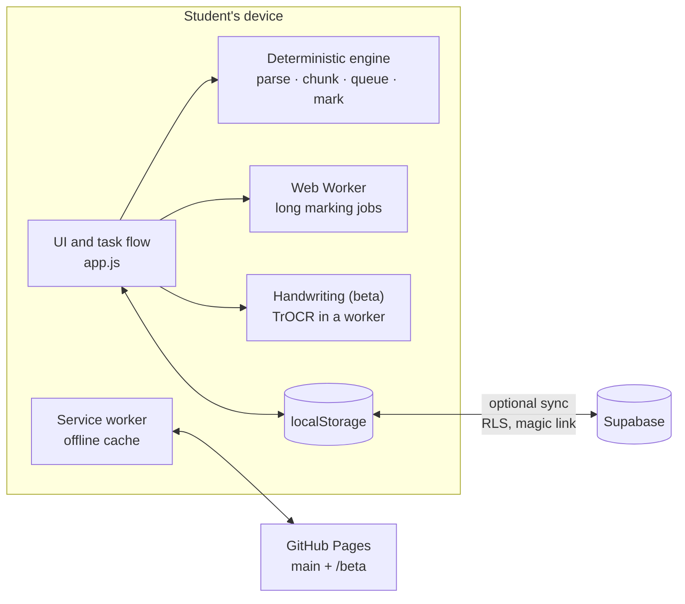

# How RecallHSC works

*The technical companion to the [README](README.md). The README covers what RecallHSC does and how to use it. This document covers how it works and why it was built this way.*

RecallHSC looks like a typing app. Underneath, it combines classical algorithms, rule-based natural-language processing, local statistics, educational design and, in the beta, a fine-tuned vision-language model that runs on the iPad. Everything here was checked against the source code, and each section links to the files it describes.

| Deep dive | What it covers |
|---|---|
| [docs/ALGORITHMS.md](docs/ALGORITHMS.md) | Essay parsing, dynamic-programming chunking, the recall engine, fuzzy marking and sequence alignment, statistics, tap-to-pick, complexity |
| [docs/HANDWRITING_AI.md](docs/HANDWRITING_AI.md) | The beta handwriting reader: TrOCR, Pencil capture, guided decoding, probability-based rescue, on-device performance, training |
| [docs/ARCHITECTURE.md](docs/ARCHITECTURE.md) | Modules, persistence, service worker, cloud sync and conflict resolution, deployment, game rendering, known limitations |
| [docs/CLOUD_SYNC.md](docs/CLOUD_SYNC.md) · [docs/ACCESSIBILITY.md](docs/ACCESSIBILITY.md) · [docs/TECHNICAL_REPORT.md](docs/TECHNICAL_REPORT.md) | Sync setup, accessibility notes, the v2 upgrade report |

---

## 1. Architecture at a glance

RecallHSC is a **local-first static web app**. It is plain JavaScript with no framework and no build step, served by GitHub Pages. All computation happens on the student's device and the source of truth is `localStorage`. Cloud sync (Supabase) and anonymous page counts (GoatCounter) are optional extras.



- **Pure engine and stateful UI are kept apart.** The parsing, chunking, task-generation and marking modules ([`js/engine/`](js/engine)) are DOM-free and run unchanged in the page, in a Web Worker and in Node tests. Golden tests pin them to the outputs of the original implementation.
- **Off the main thread.** Marking of 250 words or more runs in a dedicated worker. If the worker times out, crashes or is unavailable, the work falls back to the main thread, and three layers of checks discard results that have gone stale.
- **Offline.** A service worker precaches the app shell under a content hash (SHA-256 of every file). Each change becomes a clean new version, applied immediately just after opening or via an Update button that keeps a half-typed answer.

Details: [ARCHITECTURE.md](docs/ARCHITECTURE.md).

## 2. Turning an essay into learning material

`parseEssay` uses regular expressions and small state machines to turn pasted text into paragraphs and sentences, each labelled with a role ([ALGORITHMS.md §1](docs/ALGORITHMS.md#1-essay-parsing-and-heuristic-nlp)).

- **Normalisation:** Markdown and docx clean-up, then a quote-aware sentence splitter. It knows abbreviations (*e.g., Dr, ch., p., …*), initials and ellipses, and never ends a sentence inside an open quotation.
- **Analytical essays:**
  - every sentence gets a role: *topic sentence, lead-in, quote, analysis* or *point*;
  - sentences are grouped into evidence units, using 70 technique terms (*juxtaposition, enjambment, modality, …*) and about 40 analytical verbs;
  - when at least 60% of quoted units follow the pattern, the essay is flagged as **IQTVE**.
- **Creative and discursive pieces:**
  - each sentence is tagged with a *move*: question, turn, anecdote, reflection or line;
  - the piece is split into beats;
  - **recurring motifs** are found from n-gram statistics, and later echoes of a motif become recall tasks.

**Why rules and not an LLM?** Rules are deterministic, so the same essay always gives the same tasks and progress stays stable. They also run offline and privately, cost nothing, and run fast: parsing 5,000 words takes about 3.5 ms. When a rule gets something wrong, the reason is visible. The cost is coverage: unusual writing styles can be misread.

## 3. Chunking with dynamic programming

Each sentence is learnt a few words at a time. Rather than cutting fixed windows, `chunkSentence` scores every gap between words:

- a gap after a comma or full stop scores **+6**;
- a gap before a preposition or conjunction scores **+3**;
- a gap that would end a chunk on a function word scores **−6**;
- names are kept together, and so are short quotations.

The cut points are then chosen by a dynamic programme that minimises length cost minus gap score:

```math
B[j] = \min_{1\le L\le max}\Big(B[j-L] + c(L) - [j<n]\,G_{j-1}\Big),\qquad c(L)=0.7\,(L-\ell^*)^2 + 1.5\,[L>\ell^*+1]
```

with $c(1)=7$, and an ideal chunk length $\ell^*=3$ by default. The whole thing runs in $O(n\cdot max)$.

Fixed 4-word windows give *"…of metaphor, Malouf reveals…"*. RecallHSC gives *"use of metaphor, · Malouf reveals · that exile"*.

The full derivation, word lists and a worked example are in [ALGORITHMS.md §2](docs/ALGORITHMS.md#2-dynamic-programming-chunking).

## 4. The recall ladder

For each sentence, `buildQueue` generates a sequence of recall tasks that grow from a phrase to the whole essay:

1. Build the sentence chunk by chunk (long sentences in two halves, then whole).
2. Recall the **evidence unit** (lead-in + quote + analysis, or IQTVE).
3. Recall the **paragraph so far**, then the **full paragraph twice** at its end.
4. Recall the **whole essay so far** at checkpoints set by the essay's structure: topic sentences, unit ends, paragraph ends.

Tasks that would ask for the same text twice are removed. Students can start anywhere, and progress gives partial credit within a sentence.

The design applies retrieval practice, chunking within working-memory limits, cumulative rehearsal and a little overlearning. It is **not** a spaced-repetition scheduler: the order follows the essay's structure, not a forgetting curve. See [ALGORITHMS.md §3](docs/ALGORITHMS.md#3-the-progressive-recall-engine).

## 5. Marking: tolerant, but fair

Marking works at two levels.

**Word level.** Each word is compared with a Levenshtein edit distance, with a tolerance that grows with word length: 0 edits for words up to 2 letters, 1 for 3–6 letters, 2 for 7 or more. A typo such as *corupts* passes; *their* for *there* does not.

**Sequence level.** The typed answer is aligned with the target using optimal global alignment (Needleman–Wunsch style), built on typed arrays with cached per-word-pair verdicts. One skipped word therefore costs exactly one word, rather than shifting everything after it out of place. In a test, one skipped word plus one typo scored 9/10 with alignment, where a naive position-by-position comparison scored 3/10.

```math
acc = \min\!\Big(1,\frac{matched}{n + w\cdot extra_{interior}}\Big),\quad w=0.5\ (1\text{ in Verbatim}),\qquad \text{pass} \iff 100\,acc \ge strict\ (\text{default }88)
```

Words typed past the end of the target are free, except in Verbatim. There are four modes:

| Mode | What it checks |
|---|---|
| **Standard** | spelling-tolerant |
| **Exact words** | every word identical |
| **Strict quotes** | exact inside quotations, with a multi-sentence quotation tracked across sentences; tolerant elsewhere |
| **Verbatim** | capitals and punctuation count too |

See [ALGORITHMS.md §4](docs/ALGORITHMS.md#4-fuzzy-marking-and-sequence-alignment).

## 6. The handwriting AI (beta)

On the [beta](https://timliniscool.github.io/recallhsc/beta/), iPad students write answers with Apple Pencil. The writing is read **on the iPad**, and nothing is uploaded for recognition. The pipeline is described in [HANDWRITING_AI.md](docs/HANDWRITING_AI.md).

**The model.** It is [TrOCR-small handwritten](https://huggingface.co/microsoft/trocr-small-handwritten) (Li et al., 2021):

- encoder: a DeiT vision transformer with 12 layers, hidden size 384 and 6 heads, reading a 384 × 384 image as 576 patches of 16 × 16;
- decoder: a 6-layer, 256-dimensional, 8-head Transformer over a 64,044-token vocabulary.

RecallHSC **fine-tuned** it offline in four rounds:

- on IAM, ClozeForm and SMHD lines restyled to look like iPad ink;
- then on synthetic HSC-essay lines;
- then, in rounds 3 and 4, on hand-labelled real iPad lines from the beta (279 lines in the current model).

It is exported to ONNX (encoder in fp16 for WebGPU, int8 for CPU; decoder in int8) and runs with Transformers.js and ONNX Runtime Web.

**Around the model, RecallHSC adds:**

- **Pencil capture:** pressure-aware ink, detection of crossed-out writing (zig-zag sweep counting), and grouping strokes into ruled lines by majority vote, so descenders stay with their word.
- **Background pre-encoding:** finished lines are encoded while the student is still writing, and the encoder output is cached per line. When they press Check, usually only the last line still needs the expensive step.
- **Guided decoding:** the expected essay nudges the decoder. A token gets **+4** to its logit (×54.6 odds), or +2 for the following word, but only if it is **already in the top 8 and within 5 logits of the top**. Nothing is ever forced, so a word that was clearly written differently is still read as written.
- **Probability-based rescue:** for misread words, the expected words are scored against the ink by teacher-forced decoding. The score is a geometric-mean token probability:

  ```math
  f=\exp\big(\tfrac1K\textstyle\sum \log P(y_k\mid y_{<k},\text{image})\big)
  ```

  The expected words are accepted if any of these hold:
  - $f \ge 0.03$;
  - $f \ge 0.001$ and the misreading looks like the expected word (a handwriting-weighted edit distance where *l/i/1*, *rn/m*, *cl/d* … cost 0.3);
  - $f$ is within $e^{2.5}$ of the reader's own guess.

**The hard problem.** The reader has to tell a **memory error** (the student wrote the wrong word, which should fail) from a **recognition error** (the student wrote the right word and it was misread, which should not). The safeguards are built to limit expected-answer bias, and students can report a misread with the line images attached. Samples are collected only from signed-in beta users who leave the setting on, and are used in later offline training rounds. The model does not learn on the device.

## 7. Statistics without a generative model

Every statistic comes from timing and alignment events recorded on the device ([ALGORITHMS.md §5](docs/ALGORITHMS.md#5-statistics-and-the-memory-profile)):

- **Speed and accuracy:** WPM (characters ÷ 5 per minute), burst speed, a rhythm score from gap variability, and live accuracy computed by prefix alignment.
- **Recall rates:** first-try "warm" (chunk building) and "cold" (recall) pass rates.
- **Weak spots:**
  - the **nemesis word** (most often missed or substituted);
  - the **signature typo** (the most frequent typed → target pair);
  - the **hardest sentence**;
  - the **slip point** (the average relative position of the first error);
  - the **sharpest hour**.
- **Estimates:** the memorisation rate and a completion estimate. These are labelled as estimates in this documentation.

With sync, statistics merge across devices: counters are summed and bests take the maximum.

## 8. Mobile tap-to-pick

On phones the student can choose each next word from three options. The two decoys come from the **student's own essay** and are scored by:

- function/content class (+3 / −4);
- shared suffix (+2);
- length difference (−0.35 per letter);
- whether the decoy actually follows the previous word somewhere in the essay (+2.5);
- matching capitalisation (+0.8);
- a little randomness.

In Exact and Verbatim modes, one decoy is a deliberate misspelling or punctuation variant of the answer, which tests exactly what those modes mark. See [ALGORITHMS.md §6](docs/ALGORITHMS.md#6-tap-to-pick-distractors).

## 9. Sync and data integrity

Sync is optional, using Supabase with row-level security and magic-link sign-in.

- **Essays** are identified by a content hash (FNV-1a 64-bit). Identical texts on two devices link up instead of duplicating.
- **Conflicting edits** keep both versions: the other device's copy becomes a fork.
- **Deletions** are versioned tombstones, and a later edit brings the essay back.
- **Progress** merges only within the same revision:
  - learned sentences are combined (union), so nothing learnt is lost;
  - the most recent deliberate move wins the position;
  - a reset (a higher epoch) wins outright.
- **Statistics:** each device writes only its own row.

The merge library is pure and covered by 35 unit tests. See [ARCHITECTURE.md §5](docs/ARCHITECTURE.md#5-cloud-sync-and-conflict-resolution).

## 10. Game mode and Don

Game mode is a canvas platformer driven by recall. Each pass is a scripted jump up a procedurally placed platform: $x = W/2 + 0.27W\sin(1.9i)$. Paragraph flags and whole-essay castles mark the milestones. It renders at about 30 fps, or 2 fps with reduced motion.

Don the falcon is a 32 × 24 pixel sprite driven by a timed state machine, with paced, probabilistic speech that stays mostly quiet while the student handwrites.

The game has no physics engine and no collision detection. The motion is animation, by design: the game rewards recall, not reflexes. See [ARCHITECTURE.md §9](docs/ARCHITECTURE.md#9-gamification-and-rendering).

## 11. Complexity summary

Variables used below:

- $L$ = characters, $N$ = essay words, $n$ = target words, $m$ = typed words;
- $k$ = word length, $V$ = distinct words, $max \le 7$ = chunk size;
- $P$ = image patches (576), $T$ = decoded tokens.

| Algorithm | Time | Space |
|---|---|---|
| Normalisation, tokenising | $O(L)$ | $O(L)$ |
| Sentence segmentation | $O(L)$ typical, $O(L^2)$ worst | $O(L)$ |
| Role and move tagging | $O(N)$ | $O(N)$ |
| Motif detection | $O(6N)$ n-grams + sort | $O(N)$ |
| DP chunking | $O(n\cdot max)$ | $O(n)$ |
| Edit distance (`lev`) | $O(k^2)$ | $O(k)$ |
| Word alignment | $O(nm)$; fuzzy checks $\le$ one per distinct pair | $O(nm)$ bytes in typed arrays |
| Live accuracy | $O(m^2)$ | $O(m^2)$ |
| Distractors | $O(Vk^2 + V\log V)$ | $O(V)$ |
| Statistics update | $O(n+m)$ per attempt | bounded (maps ≤ 2,000 keys, history ≤ 60) |
| Library reconciliation | $O(\text{local} + \text{remote})$ with maps, plus some linear scans | $O(\text{essays})$ |
| Progress merge | $O(\text{sentences})$ | $O(\text{sentences})$ |
| Encoder (per line) | $O(P^2 d)$ attention × 12 layers, once per line, cached | 40-line LRU cache |
| Decoder (per line) | $O(T\cdot(T + P)\,d)$ + the guide's $O(V_{tok})$ vocabulary scan per step ($V_{tok}$ = 64,044) | |

Measured in Node: aligning a 5,000-word answer takes about 147 ms in the current engine, against 400 ms in the original implementation.

## 12. Engineering philosophy

- **Local-first.** The app works offline, essays stay on the device, and the cloud is optional.
- **Deterministic algorithms where they work.** Parsing, chunking, task generation and marking are explainable, testable and stable.
- **Learned models only where learning is genuinely needed.** Reading handwriting is a perception problem; rules cannot do it well. Even there, the model's output passes through explicit, inspectable rules (guidance limits, rescue thresholds) before it affects a mark.
- **No paid or remote AI services**, so it costs students nothing and keeps working without a connection.
- **Low latency by design:** worker marking, a cached encoder, and work done in the background before the student asks for it.
- **Explainable marking:** every check shows exactly which words were missed, substituted or added.
- **Built for HSC English:** IQTVE units, Module C reflections, quotation-strict marking and the NESA rubric guide.
- **Accessible on any device:** keyboard-only use, screen-reader announcements, reduced motion, high contrast and phone layouts (see [ACCESSIBILITY.md](docs/ACCESSIBILITY.md)).

## 13. What is experimental, and what's next

- **Production (main):** everything except handwriting.
- **Experimental (beta):** handwriting with Apple Pencil, including sample collection and the fine-tuned reader. The model is evaluated on small, single-writer test sets, so its accuracy figures are indications, not benchmarks.
- **Known limitations:** listed in [ARCHITECTURE.md §10](docs/ARCHITECTURE.md#10-known-limitations).
- **Possible future work (not implemented):**
  - incremental sync pulls;
  - spaced-repetition review scheduling;
  - more writers in the handwriting training data before handwriting comes to the main site.

## References

- Li, M. et al. (2021). *TrOCR: Transformer-based Optical Character Recognition with Pre-trained Models.* arXiv:2109.10282.
- Touvron, H. et al. (2021). *Training data-efficient image transformers & distillation through attention.* ICML.
- Vaswani, A. et al. (2017). *Attention Is All You Need.* NeurIPS.
- Levenshtein, V. I. (1966). *Binary codes capable of correcting deletions, insertions and reversals.*
- Needleman, S. B., Wunsch, C. D. (1970). *A general method applicable to the search for similarities in the amino acid sequence of two proteins.*
- Miller, G. A. (1956); Cowan, N. (2001), on working-memory capacity and chunking.
- Roediger, H. L., Karpicke, J. D. (2006). *Test-enhanced learning.* Psychological Science.
- Marti, U.-V., Bunke, H. (2002). *The IAM-database.* IJDAR.
- Upstream projects: [Transformers.js](https://github.com/huggingface/transformers.js), [ONNX Runtime](https://onnxruntime.ai/), [Supabase](https://supabase.com/), [GoatCounter](https://www.goatcounter.com/), the [IAM-line](https://huggingface.co/datasets/Teklia/IAM-line) and [ClozeFormHandwriting](https://github.com/Shrey0900/ClozeFormHandwriting) datasets.
