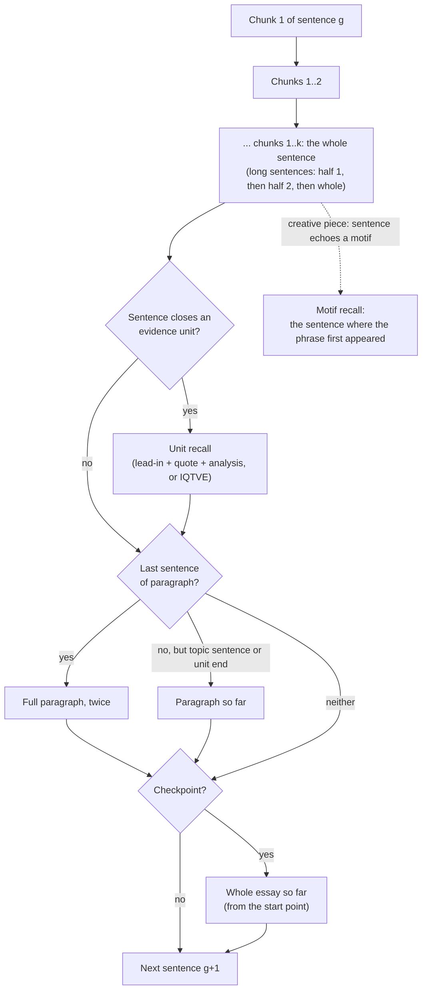

# RecallHSC algorithms

This is the detailed reference for the deterministic engine: parsing, chunking, task generation, marking, statistics and tap-to-pick. The overview is in [TECHNICAL.md](../TECHNICAL.md).

Every constant, regular expression and weight below was read from the source, and the examples were produced by running the real engine in Node. The engine files are [`js/engine/text.js`](../js/engine/text.js), [`parser.js`](../js/engine/parser.js), [`chunker.js`](../js/engine/chunker.js), [`recall.js`](../js/engine/recall.js), [`marking.js`](../js/engine/marking.js) and [`policies.js`](../js/engine/policies.js). They are plain scripts that attach to `globalThis.RecallEngine`, so the same code runs in the page, in the Web Worker and in the Node test suite.

> **Golden tests.** The engine was originally one large `index.html` and was refactored into modules. [`tests/unit/golden.test.cjs`](../tests/unit/golden.test.cjs) checks that the refactored code reproduces the original's outputs exactly (`splitSentences`, `normWord`, `items`, `chunkSentence` for maximum chunk lengths 2–7, `splitSentence`, `detectKind`, `parseEssay`, `buildQueue`). The expected outputs live in `tests/fixtures/golden.json`, which was captured from the monolith before the refactor. Behaviour described here is therefore pinned by tests.

## Contents

1. [Essay parsing and heuristic NLP](#1-essay-parsing-and-heuristic-nlp)
2. [Dynamic-programming chunking](#2-dynamic-programming-chunking)
3. [The progressive recall engine](#3-the-progressive-recall-engine)
4. [Fuzzy marking and sequence alignment](#4-fuzzy-marking-and-sequence-alignment)
5. [Statistics and the memory profile](#5-statistics-and-the-memory-profile)
6. [Tap-to-pick distractors](#6-tap-to-pick-distractors)
7. [Complexity](#7-complexity)

---

## 1. Essay parsing and heuristic NLP

`parseEssay(text, kind)` turns raw pasted text into paragraphs and sentences. Each sentence gets a role, a word count, a "unit end" flag (the end of an evidence unit) and a checkpoint flag. Everything is regular expressions and small state machines. No model or network call is involved (see [why](#why-heuristics-rather-than-a-language-model)).

### 1.1 Normalisation

**Markdown clean-up.** `mdClean` ([`text.js:16-21`](../js/engine/text.js)) runs these steps in this order:

| # | Pattern | Effect |
|---|---|---|
| 1 | `\r` | removed |
| 2 | `!\[[^\]]*\]\([^)]*\)` | Markdown images removed |
| 3 | `^\[image\d*\]:.*$` | image reference lines from docx exports removed |
| 4 | `^\s*(-{3,}\|\*{3,}\|_{3,})\s*$` | horizontal rules removed |
| 5 | `\\([\[\]\-*_()#.!>~`\|])` → `$1` | backslash escapes undone |
| 6 | `~~` | strikethrough markers removed |
| 7 | `^\s*[*+-]\s+` | bullet markers removed |
| 8 | `^#{1,6}\s+` | heading hashes removed |
| 9–11 | `**x**` → `x`, `*x*` → `x`, stray `**` removed | emphasis removed |
| 12–14 | trailing spaces removed, 3+ newlines become 2, `trim()` | whitespace tidied |

Underscore emphasis (`_x_`) and links (`[t](u)`) are left as they are.

**Comparison key.** `normWord` ([`text.js:5`](../js/engine/text.js)) is the key used for every word comparison in the app:

```js
w.toLowerCase().replace(/[’'‘`]/g,'').replace(/[^a-z0-9]/g,'')
```

It lowercases the word, drops apostrophes, and then drops anything outside ASCII letters and digits. "Don’t" becomes `dont`. Accented letters are dropped as well ("café" becomes `caf`), which is a known limitation for non-ASCII text.

`items()` splits text into paragraphs (`/\n\s*\n/`, with a break marker between them) and words (`/\s+/`). It then splits each word *after* any hyphen or dash (`/(?<=[-–—])/`), so "ten-year-old" becomes three tokens. A typed answer and the target therefore line up even when one writes "well known" and the other "well-known".

### 1.2 Sentence boundary detection

`splitSentences` ([`parser.js:6-25`](../js/engine/parser.js)) makes one left-to-right pass over the characters and tracks quotation state as it goes:

- `“` increments a depth counter, `”` decrements it (never below 0), and a straight `"` toggles a flag.
- Only `.`, `?` and `!` can end a sentence.
- A `.` next to another `.` is an ellipsis and is skipped. The single character `…` never ends a sentence.
- A `.` is skipped when the current token is an abbreviation or an initial (`/^[A-Z]\.$/`, as in "J. K. Rowling"). The abbreviation list is:

  ```js
  /^(?:e\.g|i\.e|etc|vs|cf|al|Mr|Mrs|Ms|Dr|Prof|St|Jr|Sr|ch|pp|p|vol|no|ed|eds|fig|approx|c|ca)\.$/i
  ```
- After the terminator, any closing `”’)"'` characters are consumed.
- **The split rule:** the sentence ends only if the scan is outside every quotation (depth 0 and no open straight quote) and either the text ends, or the next character is whitespace followed by `[A-Z0-9“"‘(]`.

Because terminators inside an open quotation never end a sentence, a quotation such as `He said, "Stop. Now." Then he left.` splits after `Now."` and keeps the quoted words together. A quote nested inside another (`“He cried, “Wait.” Then.”`) stays inside one sentence because of the depth counter.

<details>
<summary>Known edge cases (each verified in Node)</summary>

- `Plan B. Then it rained.` stays one sentence because `B.` looks like an initial. `The answer was no. Then…` stays one sentence because `no` is in the abbreviation list.
- `Is it? yes.` is not split, because the next sentence starts with a lowercase letter.
- An unbalanced straight `"` leaves the quote flag open, so the rest of the block is one sentence. This is safe for memorising (nothing is lost) but makes a long chunk.
- In the worst case the scan is O(L²) per block, because the last-token check re-slices from the sentence start at each terminator. Paragraphs are short, so this does not matter in practice.

</details>

### 1.3 Quotations

Quotations matter because HSC essays are built around evidence, and Strict-quotes marking holds quoted words to exact matching.

- `quotedWords(s)` returns the word count of the longest quotation in a sentence, using `“…”`, `"…"`, or a `‘…’` span that starts a word and ends at a word boundary. Apostrophes are not mistaken for single quotes.
- A **major quote** has at least 3 words. Shorter quotations count towards analysis instead.
- `endsInsideQuote` ([`policies.js:101-105`](../js/engine/policies.js)) folds the quote state across sentences. `QSTART[g]` in [`app.js`](../js/app.js) records whether sentence *g* starts inside a quotation, so a multi-sentence quotation is still treated as quoted in its later sentences.

### 1.4 Writing kind: analytical essay or creative

`detectKind` returns `'creative'` if the text looks either discursive or creative, and `'essay'` otherwise. There is no separate "discursive" kind: discursive pieces are parsed as creative. The detected kind is only the default in the upload dialog, and the student can change it.

- **looksCreative:** the text starts with "Reflection" or "Rationale"; or at least 3 lines look like headings; or more than 35% of non-empty lines have 6 words or fewer.
- **looksDiscursive** uses a discursive score:
  - *fp* = first-person words (I, I'm, I've, my, me, we, our, us) per 100 words;
  - *q* = number of `?`;
  - *refl* = reflective phrases ("perhaps", "maybe", "I wonder", "what if", "it seems", …);
  - *ana* = the share of sentences that read as analysis.

  The rule is

  $$\text{discursive} \iff ana < 0.3 \;\wedge\; [fp \ge 2.5] + [q \ge 2] + [refl \ge 2] \ge 2$$

  For comparison, on the test fixtures the sample analytical essay scores *fp* = 0.44 and *ana* = 0.28, while the discursive fixture scores *fp* = 10.4, *q* = 2, *refl* = 4 and *ana* = 0.

### 1.5 Analytical essays: roles and IQTVE units

`detectStructure` ([`parser.js:40-76`](../js/engine/parser.js)) labels the sentences of each paragraph. The roles are **ts** (topic sentence), **lead** (lead-in, shown as "Lead-in"), **quote**, **analysis** and **context** (shown as "Point"). It also groups sentences into *units*, so one quotation and the analysis that follows it are learnt together.

Two regular expressions do most of the work:

- **ANALYSIS_RX** matches sentences that open with an analytical move. These include "This", "Thus", "Ultimately", "In doing so", "By contrast" and "Through this", and also a determiner followed by up to two words and then a **technique** word, as in "The juxtaposition…", "Shakespeare's metaphor…" or "His use of anaphora…". The technique list (`TECH`) has 70 terms, including metaphor, juxtaposition, motif, enjambment, caesura, sibilance, modality and chiasmus.
- **VERB_RX** matches analytical verbs anywhere in the sentence: reveals, suggests, highlights, underscores, conveys, positions, symbolises, juxtaposes, foregrounds, epitomises, encapsulates, subverts, evinces, and about 25 more (38 verbs, most also in their *-s* form).

A sentence counts as analysis if it matches either expression, or if it contains a short (1–2 word) quotation. The state machine then applies these rules in order:

1. The first sentence of a paragraph is the topic sentence and closes a unit.
2. A sentence with a major quote joins a lead-in that is already open. It can also chain onto a quote unit as a second piece of evidence (at most 2 quotes, before any analysis). Otherwise it opens a new unit.
3. With no unit open, the sentence opens a **lead** if the next sentence has a major quote (or the one after does and this sentence isn't analysis). Otherwise it opens **context**.
4. After a quote, sentences are **analysis**:
   - the first one after the quote is always analysis;
   - more analysis continues while sentences match the patterns and the unit has fewer than 6 sentences;
   - after two or more analysis sentences, if a quote is coming up, a new lead-in opens;
   - otherwise, a unit of 5 or more sentences closes and a new context starts.

**IQTVE recognition.** The flag `formulaic` ([`parser.js:217-226`](../js/engine/parser.js)) asks whether most evidence units follow the HSC Idea–Quote–Technique–(Vocab)–Effect pattern. A unit is a **hit** if:

- it has a lead-in idea and either a bare quote (9 or fewer words outside the quotation) or a named technique in the quote or the first 8 words after it; or
- it has both a bare quote and a named technique.

$$\text{formulaic} \iff units \ge 3 \;\wedge\; \frac{hits}{units} \ge 0.6$$

The flag only changes the unit's label ("IQTVE" or "Quote + analysis"). It does not change the tasks.

### 1.6 Creative and discursive pieces: "moves" and motifs

Creative pieces have no topic sentences. `tagMoves` instead labels each sentence by the move it makes:

| Move | Rule (first match wins) |
|---|---|
| **question** | the sentence ends in `?` (allowing closing quotes or brackets) |
| **turn** | it opens with *but, and yet, yet, still, however, instead, then again, even so, except, and now, only now* |
| **anecdote** | it contains *I remember, I was, when I, years ago, as a child, that summer/night/…, my mother/father/nan/…* |
| **reflect** | it contains *perhaps, maybe, I think/wonder/suppose/believe/know, we tend/often/forget/…, it seems, what if, there is something* |
| (fallback) | it counts past-tense and present-tense verbs: present-tense with abstract vocabulary is **reflect**; otherwise any tense is **anecdote**; otherwise it inherits the previous move |
| **line** | overrides the above: a short (8 words or fewer) unquoted sentence that ends a block or stands alone, such as a one-line paragraph or a closing line |

The piece is split into **beats** at lines, at turns, at a new anecdote after reflection, or after 5 sentences. Whole-piece checkpoints fall at a turn when at least 60 words have passed since the last checkpoint, or at the end of a section after 150 words or before a heading. A heading that reads "Reflection" or "Rationale" switches the rest of the piece back to analytical parsing. That handles the HSC Module C pattern of a creative piece followed by a reflection statement.

**Recurring motifs** (`markMotifs`, [`parser.js:135-157`](../js/engine/parser.js), creative pieces only). The goal is to find a phrase the writer deliberately repeats, such as "nothing is ever really empty", and drill it at the point where it comes back. A candidate phrase:

- is an n-gram of 1–6 tokens;
- does not start or end on a function word;
- contains at least one content word of 4 or more letters;
- if it is a single word, has at least 6 letters;
- appears in at least 2 different paragraphs, at least twice (3 times for single words).

Candidates are ranked by length and then frequency. A phrase is dropped if it is too common (more than max(3, 0.4 × the number of sentences) occurrences) or if it is contained in a phrase already kept. The top 6 are kept, ranked by occurrences × min(4, words). At the first later appearance of each motif in a new paragraph, the sentence gets an `echo`, which generates a **motif recall task** (§3). On the discursive test fixture this finds `["nothing is ever really empty", "remember"]`.

### Why heuristics rather than a language model

- **Determinism:** the same essay always produces the same tasks, which is what makes the golden tests possible and keeps a student's progress stable between sessions and devices.
- **Offline use and privacy:** it works offline, essays never leave the device for parsing, and nothing costs money per request.
- **Speed:** parsing a 5,000-word essay takes about 3.5 ms in Node (`npm run test:performance`).
- **Explainable failures:** a misclassified sentence comes from a specific, readable rule.

The cost is coverage: unusual styles can be misread, and the student can correct the essay kind at upload.

---

## 2. Dynamic-programming chunking

Each sentence is learnt a few words at a time. Cutting into fixed-length chunks breaks phrases in unnatural places ("of metaphor, Malouf reveals"). `chunkSentence(text, max)` ([`chunker.js`](../js/engine/chunker.js)) instead chooses the cut points that minimise a cost: each chunk pays a length cost, and each cut is rewarded or penalised by how natural a break it is.

### 2.1 Word lists

| List | Purpose | Members |
|---|---|---|
| **FN** (function words) | a chunk should never *end* on one | a an the of to in on at by for from with into onto upon as than and or but nor so yet that which who whom whose this these those his her its their our my your it he she they we i is was are were be been has have had not no very more most such |
| **BREAK** | a good word to *start* a chunk | prepositions (of, in, on, at, by, for, from, with, into, through, beyond, among, between, against, without, within, about, across, after, before, during, toward(s), under, over, beneath, behind, despite, via), conjunctions (and, or, but, yet, so, nor, while, whereas, although, though, because, since, until, unless, as, if, when, whenever, where, wherever), relatives (which, who, whom, whose, that, how, what, why), even, rather, than |
| **DET** | a weaker chunk start | the a an his her its their this these those our my your every each such another |

`bare(x)` lowercases the word, strips surrounding quote marks, brackets and punctuation, and strips a final `’s`.

### 2.2 Gap scores

Let $w_0 … w_{n-1}$ be the words. The gap $g_i$ sits between $w_i$ and $w_{i+1}$, and its score $G_i$ comes from the **first** matching rule:

| Rule | $G_i$ |
|---|---:|
| $w_i$ ends with `, ; : — – )` or `. ? !` (allowing a closing quote) | **+6** |
| $w_{i+1}$ starts with `( — –` | **+5** |
| the gap is inside a short quotation (at most *max* + 1 words) | **−4** |
| $w_{i+1}$ opens a quotation, or $w_i$ closes one | **+4** |
| `bare`($w_i$) ∈ FN (don't end a chunk on a function word) | **−6** |
| both words are capitalised (keep names together: "Springfield Elementary") | **−3** |
| `bare`($w_{i+1}$) = "of" (keep "X of Y" together) | **0** |
| `bare`($w_{i+1}$) ∈ BREAK | **+3** |
| `bare`($w_{i+1}$) ∈ DET | **+2** |
| otherwise | **0** |

The punctuation rule is checked before the short-quote rule, so a comma inside a short quotation can still be a cut. In the example below, "Out, | damned spot!" splits at the comma.

### 2.3 Length cost and recurrence

Let *max* be the maximum chunk length (Settings: default 4, clamped to 2–7) and let $\ell^* = \max(2, \min(3, max-1))$ be the ideal length: 3 when *max* is 4 or more, otherwise 2.

$$
c(L) = \begin{cases}
7 & L = 1 \\
99 & L > max \\
0.7\,(L-\ell^*)^2 + 1.5\,[L > \ell^*+1] & \text{otherwise}
\end{cases}
$$

With $\ell^* = 3$: $c(1)=7,\ c(2)=0.7,\ c(3)=0,\ c(4)=0.7,\ c(5)=4.3,\ c(6)=7.8,\ c(7)=12.7$.

The DP finds the cheapest segmentation of the first $j$ words. A cut after word $j-1$ earns that gap's score, and the end of the sentence earns nothing:

$$
B[0]=0,\qquad
B[j] = \min_{1 \le L \le \min(max,\,j)} \Big( B[j-L] + c(L) - [j<n]\,G_{j-1} \Big)
$$

`from[j]` stores the minimising $L$. A strict `<` comparison is used, so ties go to the shortest $L$. Backtracking from $j=n$ along `from` and reversing gives the chunks.

```text
function chunkSentence(words, max):
    n ← |words|
    if n ≤ max(2, max−1): return [words]          # short sentence: one chunk
    G ← gapScores(words)                          # table above, O(n)
    B[0] ← 0
    for j in 1..n:
        B[j] ← ∞
        for L in 1..min(max, j):
            cost ← B[j−L] + c(L) − (j < n ? G[j−1] : 0)
            if cost < B[j]: B[j] ← cost; from[j] ← L
    chunks ← []; j ← n
    while j > 0: chunks.prepend(words[j−from[j] .. j−1]); j ← j − from[j]
    return chunks
```

**Complexity:** O(n·max) time and O(n) space. Because *max* is at most 7, this is effectively linear.

### 2.4 Worked example

The sentence is *"Through the deft use of metaphor, Malouf reveals that exile is a state of mind rather than a place."* (19 words). These are the gap scores the engine computes:

```text
Through|the +2   the|deft −6   deft|use 0   use|of 0   of|metaphor, −6   metaphor,|Malouf +6
Malouf|reveals 0   reveals|that +3   that|exile −6   exile|is 0   is|a −6   a|state −6
state|of 0   of|mind −6   mind|rather +3   rather|than +3   than|a −6   a|place. −6
```

| Method | Chunks |
|---|---|
| Fixed 4-word windows | Through the deft use · **of metaphor, Malouf reveals** · that exile is a · state of mind rather · than a place. |
| RecallHSC, *max* = 4 (default) | Through the deft · use of metaphor, · Malouf reveals · that exile · is a state · of mind rather · than a place. |
| RecallHSC, *max* = 2 | Through the · deft use · of metaphor, · Malouf reveals · that exile · is a · state · of mind · rather than · a place. |

The DP cuts at the comma (+6), never ends a chunk on "the", "of", "a" or "that" (−6), and prefers 3-word chunks. One weakness is visible: "rather than" is split, because both gaps around it score +3 and the length cost prefers 3-word chunks. These are tunable heuristics, not a parser.

### 2.5 Long sentences

`splitSentence` ([`parser.js:229-242`](../js/engine/parser.js)) splits sentences of 20 or more words into two halves before chunking.

- A break is allowed after a word ending in `, ; :`, at a dash, or before an opening quotation.
- A break is never allowed inside a quotation.
- The first half must have at least 4 words and the second at least 6.
- Among the allowed breaks, the one closest to $n/2$ wins.

If no break qualifies, the sentence is chunked whole. Each half is chunked separately and then the whole sentence is recalled (§3).

---

## 3. The progressive recall engine

`buildQueue(ctx, g)` ([`recall.js`](../js/engine/recall.js)) builds the list of tasks for sentence *g*. The student works through it in order. Each task asks for a span of text from memory (blank box, nothing shown), and the target spans get larger as the student goes:



### 3.1 Task types

| Type | Text to recall | When it is generated |
|---|---|---|
| `build` | chunks 1..k of sentence *g* (k = 1..n) | every sentence; for long sentences, half 1's chunks then half 2's (half 2 tasks carry `pre`, the text of half 1) |
| `sent` | the whole sentence | only after a long sentence has been learnt in halves (for short sentences, the last build task already is the whole sentence) |
| `unit` | from the start of the current unit to *g* | inside a multi-sentence paragraph when the unit spans more than one sentence; flagged `iq` when it contains a quotation |
| `para` | from the paragraph start (or the start point, if later) to *g* | when *g* is a topic sentence or closes a unit |
| `para` with `rep:1` and `rep:2` | the **whole** paragraph, twice | on the last sentence of a multi-sentence paragraph |
| `motif` | the sentence where the motif first appeared | creative pieces, on a sentence with an `echo` |
| `essay` | from the start point to *g* | at every checkpoint (`cp`), if Settings → whole-essay recalls is on |

**Checkpoints** are defined by structure, not by a fixed interval. In analytical essays they fall at every topic sentence, every unit end and every paragraph end. In creative pieces they follow the word thresholds in §1.6.

**Duplicate elimination** ([`recall.js:39-47`](../js/engine/recall.js)) removes tasks that would ask for the same text twice. A task is dropped if:

- it has the same text as the previous task (unless it is a `rep` paragraph);
- it is an `essay` task whose text equals any `para`, `unit` or `sent` task;
- it is a `unit` or a plain `para` task whose text equals a `sent` task;
- it is a plain `para` task whose text equals a `unit` task.

For example, the first sentence of an essay produces only build tasks: its "essay so far" would be the same text as the last chunk.

<details>
<summary>An actual generated queue (formulaic test fixture, default settings)</summary>

```text
g=0 (solo paragraph): build 1..5/5                (essay checkpoint dropped: equals the last build)
g=1 (topic sentence): build 1..4/4; essay 0–1
g=3 (quote):          build 1..6/6; unit 2–3 (iq)
g=5 (unit end):       build 1..3/3; unit 2–5 (iq, done); para 1–5; essay 0–5
g=9 (paragraph end):  build 1..3/3; unit 6–9; para 1–9 ×2 (rep 1, rep 2); essay 0–9
```

A long sentence (the sample essay, 28 words): `build half 1, 1..3/3; build half 2, 1..6/6; sent`.

</details>

### 3.2 Start point and progress

- **Start point.** Students can start anywhere (`startG`). Every task's span is clipped to start no earlier than the start point. Choosing a sentence on the map either marks everything before it as known, or makes it the new start.
- **Progress.** A pass on a task that covers whole sentences marks them `learned`. Passing every build chunk sets partial credit `S.part = {g, w}`. Progress is

  $$\text{progress} = \frac{\sum_{g:\,learned} wc_g \;+\; \min(part.w,\ wc_{part.g})}{\sum_g wc_g}$$

  Skipping a task never marks anything learned.

### 3.3 How this relates to learning research

The design follows well-established findings. It does not claim to be a new learning theory:

- **Retrieval practice and the testing effect** (Roediger & Karpicke, 2006): every task is recall from a blank box, never re-reading.
- **Chunking and working-memory limits** (Miller, 1956; Cowan, 2001): new material arrives in small, meaningful chunks. The default maximum of 4 words sits within commonly cited estimates of working-memory capacity.
- **Cumulative rehearsal:** each new piece is immediately joined to what came before (sentence → unit → paragraph → essay), so earlier material is retrieved again and again as the essay grows.
- **Overlearning:** the full paragraph is recalled twice at its end, and whole-essay checkpoints keep re-testing material that has already passed.

**RecallHSC is not a spaced-repetition system.** There is no forgetting curve, no review scheduling by elapsed time, and no per-item interval. The ordering is purely structural: it follows the essay.

---

## 4. Fuzzy marking and sequence alignment

Marking has to answer one question: *did the student recall this text?* It must not punish an obvious typo, and it must not let a later word count as correct just because one earlier word was skipped. RecallHSC does this in two levels:

1. a tolerant comparison of individual words (edit distance);
2. an optimal alignment of the two word sequences.

### 4.1 Word comparison: Levenshtein with a length-dependent tolerance

`lev(a,b)` ([`marking.js:6-11`](../js/engine/marking.js)) is the classic unit-cost edit distance (Levenshtein, 1966; Wagner & Fischer, 1974), kept as two rolling rows:

$$
D_{i,0}=i,\quad D_{0,j}=j,\quad
D_{i,j}=\min\big(D_{i-1,j}+1,\ D_{i,j-1}+1,\ D_{i-1,j-1}+[a_i\ne b_j]\big)
$$

`fuzzy(a,b)` accepts a typed word if the distance is within a tolerance that grows with word length. $L$ is the length of the longer word:

$$
tol(L) = \begin{cases} 0 & L \le 2 \\ 1 & 3 \le L \le 6 \\ 2 & L \ge 7 \end{cases}
\qquad
\text{fuzzy}(a,b) \iff \big||a|-|b|\big| \le tol \;\wedge\; D(a,b) \le tol
$$

The length check rejects most non-matches cheaply, before the O(k²) distance is computed. Some examples:

- *corupts* = *corrupts* (1 edit; 8 letters allow 2);
- *ambitoin* = *ambition* (a swap costs 2 edits; 8 letters allow 2);
- *their* ≠ *there* (2 edits; 5 letters allow only 1);
- *ab* ≠ *ac* (1 edit; 2 letters allow none).

Short words must be exact, because one letter changes their meaning ("in"/"on").

### 4.2 Sequence alignment

The target words $T_1..T_n$ and the typed words $U_1..U_m$ are aligned with a global alignment DP (Needleman & Wunsch, 1970) where every operation costs 1:

$$
A_{i,j} = \min\big(A_{i-1,j-1} + [\neg\,\text{match}(T_i,U_j)],\ \ A_{i-1,j}+1\ (\text{missed}),\ \ A_{i,j-1}+1\ (\text{extra})\big)
$$

Backtracking from $(n,m)$ produces a list of operations:

- **ok**: matched;
- **sub**: a wrong word;
- **del**: a target word that was missed;
- **ins**: an extra typed word.

Ties prefer the diagonal step, then a deletion, then an insertion. The implementation (`alignCore`, [`policies.js:38-58`](../js/engine/policies.js)) uses flat typed arrays: a `Uint16Array` for costs and a `Uint8Array` for match bits. Each distinct word is mapped to an integer id. The `fuzzy` verdict for each (target, typed) word pair is cached in an `Int8Array` of size $V^2$ (or a `Map` when $V^2 > 8\times10^6$), so `fuzzy` runs at most once per distinct pair. A pair can only match if it lies within 220 words of the diagonal; this stops a repeated word far away from creating a misleading match.

**Scoring.** Let *ok* be the number of matches. A *trailing* extra word is one typed after the end of the target ("typing ahead"). An *interior* extra word is any other extra word.

$$
acc = \min\!\left(1,\ \frac{ok}{n + w\cdot interior}\right),\qquad
w = \begin{cases}0.5 & \text{Standard, Exact, Strict quotes}\\ 1 & \text{Verbatim}\end{cases}
$$

Trailing extras are free except in Verbatim. The task passes if

$$
100\cdot acc \ge strict \quad (\text{default } 88,\ \text{range } 60\text{–}100)
$$

and, in Strict-quotes mode, if additionally no quoted word is wrong or missing.

**Why alignment matters.** In the example below the student skipped one word and made one typo:

```text
Target: Shakespeare reveals that unchecked ambition ultimately corrupts the human spirit.
Typed:  Shakespeare reveals that ambition ultimately corupts the human spirit and more

ok  shakespeare   ok reveals   ok that   del unchecked   ok ambition   ok ultimately
ok  corrupts←corupts   ok the   ok human   ok spirit   ins and   ins more

Standard: ok = 9, trail = 2  →  acc = 9/10 = 90%  → pass at 88
Naive position-by-position comparison: 3/10
Exact words 80%   Strict quotes 90%   Verbatim 58%  (= 7/12)
```

A position-by-position comparison would mark every word after the missing "unchecked" as wrong. The alignment charges for exactly one missed word.

### 4.3 Marking modes

The mode is set in Settings and stays fixed for an attempt once it starts.

| Mode | Normalisation | Word match | Extra words | Extra rule |
|---|---|---|---|---|
| **Standard** (default) | `normWord` (case, punctuation and apostrophes ignored) | `fuzzy` | interior ×0.5, trailing free | none |
| **Exact words** | `normWord` | identical | interior ×0.5, trailing free | none |
| **Strict quotes** | `normWord` | exact inside quotations, `fuzzy` outside | interior ×0.5, trailing free | every quoted word must be right |
| **Verbatim** | literal, after folding curly quotes, dashes, `…` and non-breaking spaces to their keyboard forms | identical | everything counts ×1 | capitals, punctuation and apostrophes all count |

Strict-quotes mode finds quotation spans with `quoteMask` ([`policies.js:86-99`](../js/engine/policies.js)), using the essay text and the carried-over `QSTART` state. Apostrophes never toggle a quotation.

**The trade-off.** A strict marker frustrates students with false failures over typos that have nothing to do with memory. A lenient one lets real gaps pass. Standard mode sits in between: short words must be exact, long words tolerate 1–2 edits, and missing words always cost. Students who want exactness, such as for quotations they will reproduce word for word, can choose a stricter mode.

### 4.4 Worker marking and stale results

Final marking and live accuracy run through [`worker-manager.js`](../js/workers/worker-manager.js), which manages a dedicated Web Worker ([`compute.worker.js`](../js/workers/compute.worker.js)).

**When a job runs inline.** Jobs smaller than 250 words run inline on the main thread, where the overhead of sending them to the worker would cost more than the work. A job also runs inline when the worker is unavailable.

**Failures.** A worker that times out (10 s), throws an error, or fails to post a message is restarted. Any jobs it was holding are recomputed on the main thread. After more than 3 restarts the worker is disabled and everything runs inline.

**Stale results.** Three layers stop an old result from being shown:

1. On each channel (`mark`, `live`) only the latest request counts. Older ones resolve to a `STALE` sentinel.
2. `markSeq` is incremented on every essay load, task change, retry and mode change.
3. Before a result is applied, the app checks that the essay, the task, the reset epoch and the current phase are all still the same.

Measured in Node (`npm run test:performance`, means; "old" is the original monolith's algorithm, "new" is the current engine):

| Words | align/mark, old | align/mark, new |
|---:|---:|---:|
| 500 | 21.2 ms | 2.9 ms |
| 2,000 | 123 ms | 27.5 ms |
| 5,000 | 400 ms | 147 ms |

The current numbers include tokenising both texts. The benchmark also checks that both versions return identical results.

---

## 5. Statistics and the memory profile

All statistics are computed locally from interaction events in [`app.js`](../js/app.js) and stored per essay. No generative AI is involved. The table separates what is **measured** from what is **estimated** or **heuristic**.

| Statistic | Definition | Kind |
|---|---|---|
| WPM | characters typed ÷ 5 ÷ minutes since the first input | measured |
| Burst | characters inserted in the last 3 s × 20 ÷ 5 | measured |
| Rhythm | $\max(0,\ 100 - 60\cdot \sigma/\mu)$ of the last 40 gaps between inputs | heuristic score |
| Live accuracy | the mode's alignment of what has been typed against the same-length prefix of the target, at most every 400 ms | measured |
| Hesitations | gaps between inputs over 1.2 s | measured |
| Warm recall | first-try pass rate on chunk-building tasks | measured |
| Cold recall | first-try pass rate on all other recall tasks | measured |
| First-word recall | attempts whose first letter matches the target's first word | measured (by first letter, not the whole word) |
| Nemesis word | the target word (more than 2 letters) most often substituted or missed | measured |
| Signature typo | the most frequent (typed → target) substitution pair | measured |
| Hardest sentence | the sentence where failed attempts most often first go wrong | measured |
| Slip point | the average position of the first error, as a fraction of the answer | measured |
| Correction rate | deletions ÷ input events | measured (counts input events, not physical keys) |
| Sharpest hour | the local hour with the highest mean accuracy among hours with at least 3 attempts | measured |
| Memorise rate | words learnt ÷ study hours, where study time sums gaps between inputs under 20 s | measured (excludes reading time) |
| Done by / Finish in | words remaining ÷ rate | **estimate** (assumes a constant rate) |
| Finger travel, booklet pages | 0.019 m per key; 250 words per page | **heuristic constants** |
| History | the last 60 attempts (accuracy, pass/fail) | measured |

With cloud sync on, counters are summed across devices, maxima are taken across devices, and history stays per device ([`conflict.js`](../js/sync/conflict.js) `mergeStats`).

---

## 6. Tap-to-pick distractors

On phones (a coarse pointer and a short side under 600 px) the student can build an answer by tapping one of three words instead of typing. Random wrong options would be too easy to rule out, so `decoys()` ([`app.js`](../js/app.js)) chooses plausible ones **from the student's own essay**:

$$
score(w) = U(0,1.5) + \begin{cases}+3 & \text{same function/content class as the answer}\\ -4 & \text{otherwise}\end{cases}
+ 2\,[\text{shares the answer's suffix}] - 0.35\,\big||w|-|r|\big| + 2.5\,[\text{follows the previous word in the essay}] + 0.8\,[\text{same capitalisation}]
$$

- Words within one edit of the answer are excluded, so a distractor is never a misspelling of the answer. The exception is the stricter modes below, where a misspelling is deliberately offered.
- Suffixes: *ing, ed, ly, tion, sion, ment, ness, ity, ous, ive, al, er, est, s*.
- The "follows the previous word" feature is a bigram over the essay.
- The only grammatical feature is whether a word is a function word or a content word. There is **no part-of-speech tagger**.
- Two decoys are drawn from the 8 best-scoring words, each picked uniformly from the top 4 remaining, then shuffled with the correct answer (Fisher–Yates).
- In **Verbatim**, one option is the correct word with different punctuation or capitalisation. In **Exact** (and inside quotations in Strict quotes), one option is a misspelling of the correct word. This tests precisely what those modes mark.

---

## 7. Complexity

Variables used below:

- $n$ = target words, $m$ = typed words, $k$ = word length;
- $L$ = characters in a block, $N$ = words in the essay, $V$ = distinct words;
- $max$ = maximum chunk length (at most 7).

| Algorithm | Time | Space | Notes |
|---|---|---|---|
| `mdClean`, `items`, `tokens` | $O(L)$ | $O(L)$ | a fixed number of regex passes |
| `splitSentences` | $O(L)$ typical, $O(L^2)$ worst | $O(L)$ | re-slices at each terminator |
| `detectStructure`, `tagMoves` | $O(N)$ | $O(N)$ | constant regex work per sentence |
| `markMotifs` | $O(N\cdot 6)$ n-grams plus sorting the candidates | $O(N)$ | creative pieces only |
| `chunkSentence` | $O(n\cdot max)$ | $O(n)$ | effectively linear |
| `splitSentence` | $O(n)$ | $O(n)$ | |
| `buildQueue` | $O(N)$ per sentence | $O(N)$ | builds the paragraph and essay text |
| `lev` | $O(k^2)$ | $O(k)$ | two rolling rows |
| `fuzzy` | $O(1)$ on a length reject, else $O(k^2)$ | $O(k)$ | |
| alignment | $O(n\,m)$ | $O(n\,m)$ bytes ×3 | typed arrays; fuzzy calls cached per distinct pair ($\le V^2$) |
| live accuracy | $O(m^2)$ | $O(m^2)$ | prefix alignment |
| `decoys` | $O(V k^2 + V\log V)$ | $O(V)$ | vocabulary built once per essay, $O(N)$ |
| statistics update | $O(n+m)$ per attempt | $O(1)$ amortised | maps capped at 2,000 keys, history at 60 |

## References

- V. I. Levenshtein (1966). Binary codes capable of correcting deletions, insertions, and reversals. *Soviet Physics Doklady* 10(8).
- R. A. Wagner, M. J. Fischer (1974). The string-to-string correction problem. *Journal of the ACM* 21(1).
- S. B. Needleman, C. D. Wunsch (1970). A general method applicable to the search for similarities in the amino acid sequence of two proteins. *Journal of Molecular Biology* 48(3).
- G. A. Miller (1956). The magical number seven, plus or minus two. *Psychological Review* 63(2).
- N. Cowan (2001). The magical number 4 in short-term memory. *Behavioral and Brain Sciences* 24(1).
- H. L. Roediger, J. D. Karpicke (2006). Test-enhanced learning: taking memory tests improves long-term retention. *Psychological Science* 17(3).
