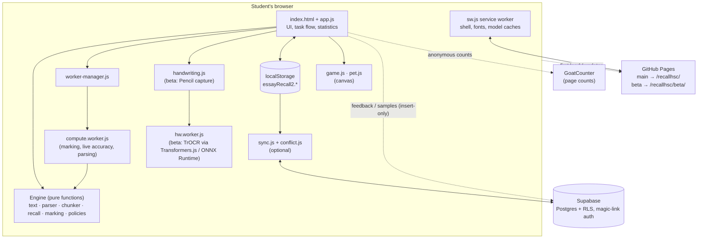

# RecallHSC architecture

This document covers how RecallHSC is put together: modules, state, persistence, offline support, cloud sync and conflict resolution, deployment, the differences between the main and beta sites, and the game layer. For an overview, see [TECHNICAL.md](../TECHNICAL.md).

## Contents

1. [Shape of the system](#1-shape-of-the-system)
2. [Modules and load order](#2-modules-and-load-order)
3. [State and local persistence](#3-state-and-local-persistence)
4. [Offline: the service worker](#4-offline-the-service-worker)
5. [Cloud sync and conflict resolution](#5-cloud-sync-and-conflict-resolution)
6. [Backups](#6-backups)
7. [Privacy, security and telemetry](#7-privacy-security-and-telemetry)
8. [Deployment: main and beta](#8-deployment-main-and-beta)
9. [Gamification and rendering](#9-gamification-and-rendering)
10. [Known limitations](#10-known-limitations)

---

## 1. Shape of the system

RecallHSC is a **local-first static web app**. It has no application server and no build step. Plain scripts are served from GitHub Pages, all computation happens in the browser, and the source of truth is the device's `localStorage`.

Two optional services exist:

- **Supabase**, used for cloud sync and for collecting feedback (insert-only);
- **GoatCounter**, used for anonymous page counts.

The app works fully without either.



## 2. Modules and load order

Every script is a classic `<script>` loaded in this order ([`index.html`](../index.html)):

1. **Engine:** `text` → `chunker` → `parser` → `marking` → `policies`
2. `worker-manager`, then `recall`
3. `toolkit`, `app`, `pet`, `game`, `boot`, `a11y/dialogs`
4. **Sync:** `sync/config` → `sync/conflict` → `sync/sync`
5. `pwa`, `analytics`, `handwriting` (beta only), `beta-invite`, `feedback`

| Module | Responsibility |
|---|---|
| [`js/engine/*`](../js/engine) | Pure, DOM-free algorithms ([ALGORITHMS.md](ALGORITHMS.md)). They attach to `globalThis.RecallEngine`, so the page, the worker and Node all load the same files. |
| [`js/app.js`](../js/app.js) | State (`S`, `SET`, `LIB`, `ACTIVE`), the task flow (`loadTask`, `check`, `next`), rendering, statistics, settings, backups. |
| [`js/boot.js`](../js/boot.js) | First paint and view switching. |
| [`js/workers/*`](../js/workers) | Off-main-thread marking, with inline fallback and stale-result protection ([ALGORITHMS.md §4.4](ALGORITHMS.md#44-worker-marking-and-stale-results)). |
| [`js/sync/*`](../js/sync) | Optional cloud sync. `conflict.js` is a pure merge library (no DOM, no clock, no randomness), and Node tests `require` it. |
| [`js/pwa/pwa.js`](../js/pwa/pwa.js) | Service worker registration, install prompt, update flow. |
| [`js/a11y/dialogs.js`](../js/a11y/dialogs.js) | Accessible modal dialogs (focus trap, Escape, focus return). |
| [`js/game.js`](../js/game.js), [`js/pet.js`](../js/pet.js) | The canvas platformer and Don the falcon (§9). |
| [`js/toolkit.js`](../js/toolkit.js) | Unlocks the encrypted NSBHS toolkit (§7). |
| [`js/feedback.js`](../js/feedback.js), [`js/analytics.js`](../js/analytics.js) | Marking reports and anonymous counts. |

Modules communicate through shared globals and a few named singletons (`Game`, `Pet`, `RecallSync`, `HW`, `Toolkit`, `RecallFeedback`) rather than through an event bus. This is a deliberate choice: there is no bundler, so this is the simplest structure that works. The pure engine and merge code is kept separate from the stateful UI code, so the parts that most need testing can be tested in Node.

The **Content Security Policy** restricts scripts to the site itself, and network connections to the site, Supabase and GoatCounter. Beta also allows `'wasm-unsafe-eval'` for ONNX Runtime, plus the Hugging Face hosts used by the `?m=xenova` comparison switch.

## 3. State and local persistence

Everything is stored under the prefix `essayRecall2.` in `localStorage`.

| Key | Contents |
|---|---|
| `settings` | `SET`: marking mode, pass mark (`strict`, 60–100, default 88), chunk size (`phrase`, 2–7, default 4), reveal delay, accessibility options, view |
| `lib` | uploaded essays `{id, title ≤ 60, text ≤ 200 000, kind, src, updated}`, at most 200 |
| `state.<essayId>` | progress `S`: `g` (sentence), `ti` (task), `startG`, `learned[]`, `part`, `posAt`, `epoch`, `resetAt`, `rev`, `stats`, `game`, plus `hw` on beta |
| `active` | the open essay |
| `cloud`, `syncQueue`, `cloudStats`, `device`, `auth` | sync bookkeeping (§5) |

**Validation.** Every value read from storage, a backup or the cloud passes through a sanitiser (`cleanSettings`, `cleanState`, `cleanLib`):

- settings are whitelisted and clamped to valid ranges;
- maps are capped at 2,000 keys and history at 60 entries;
- identifiers and revisions are pattern-checked.

Corrupted or hostile data therefore cannot crash the app or bloat storage. An end-to-end test covers corrupted storage.

**When data is saved.** `save()` runs on every task change, essay switch, reset and sync merge, and on `pagehide`. If storage is full, the student gets a one-time message rather than a silent loss.

**Several tabs open at once.** A `storage` event listener merges progress from other open tabs:

- a more recent reset wins;
- learned flags are combined (OR);
- the most recent *move* wins the position (`posAt`, the time of a deliberate move);
- partial progress takes the furthest value.

The current task reloads only if the student is not in the middle of an answer (on beta that includes handwriting on the sheet). Statistics and game state are not merged between tabs: the tab that saves last wins.

## 4. Offline: the service worker

[`sw.js`](../sw.js) makes the app work offline after the first visit.

| Request | Strategy |
|---|---|
| App shell (35 files on beta, 34 on main) | precached as one versioned set, in a cache named after the site (`recallhsc-shell-<site>@<version>-<hash>`), and served cache-first |
| Page navigations | cached `index.html`. Other `.html` pages such as the privacy page are served as themselves. Offline with nothing cached: a short notice |
| Google Fonts | stylesheet stale-while-revalidate, font files cache-first |
| `models/` (beta) | cache-first in a separate **`recallhsc-model-<version>`** cache that survives app updates |
| Supabase, GoatCounter, other sites | not intercepted, never cached |
| `/beta/…` from the main site's worker | passed through to the network, so each site has its own worker |

**Detecting new versions.** [`tools/stamp-sw.cjs`](../tools/stamp-sw.cjs) hashes every precached file with SHA-256 (line endings normalised) and writes the first 12 hex digits into `ASSET_HASH`. Any content change produces a new cache name, so the browser treats it as a new version. `--check` fails CI if the stamp is out of date.

**Update flow** ([`pwa.js`](../js/pwa/pwa.js)):

- If a new version is found within 8 seconds of opening the app, and nothing is being typed or written, it switches immediately.
- Otherwise it shows an **Update** bar.
- Applying an update first saves progress and stashes any half-typed answer. It reloads once and puts the answer back, if the same task is still open within 10 minutes.

## 5. Cloud sync and conflict resolution

Sync is optional. Students sign in with a passwordless **magic link** (Supabase Auth, PKCE flow), and data goes to four tables protected by **row-level security**. Every row can be read and written only by its owner (`auth.uid() = user_id`), and the anonymous role has no access. The schema is in [`supabase/migrations/`](../supabase/migrations), and the setup is described in [CLOUD_SYNC.md](CLOUD_SYNC.md).

| Table | Key | Holds |
|---|---|---|
| `essays` | (user, essay_id) | title, body, kind, `rev`, `ver`, deletion tombstone |
| `progress` | (user, essay_id, rev) | learned bitstring (`'0'/'1'`, at most 20,000), position, start, epoch, part, game |
| `stats` | (user, essay_id, device_id) | each device's own statistics |
| `prefs` | (user) | synced settings (mode, pass mark, delay, chunk size, accessibility, …) |

**Scheduling.** A change marks the data as dirty and schedules a pass after **4 s** (debounced). Passes also run:

- when the device comes back online;
- when the tab becomes visible (after 500 ms);
- every 5 minutes.

Failed passes back off exponentially with jitter:

```math
t = \min(300\,\text{s},\ 2\,\text{s}\cdot 2^{\min(fails,8)}) \times U(0.5, 1.5)
```

A pass makes one full reconciliation: library, then progress, then stats, then settings. Only one pass runs at a time.

### 5.1 Essay identity and revisions

- **Revision.** An essay's revision is a content hash: `rev = "r" + FNV-1a-64(kind + "\0" + normalised text)`, with line endings and trailing spaces normalised. Two devices holding the same text agree on the revision even if the essay was pasted separately on each.
- **Linking.** An essay that exists on only one device, but whose text exactly matches an essay already in the cloud, is **linked** to that cloud essay rather than uploaded twice.
- **Forking.** If both devices edited the same essay since the last sync, the local version is uploaded and the remote version is kept as a **fork**, titled "(other device)". Nothing is silently lost.
- **Deletions.** These travel as **tombstones** with a version number. A deletion wins only over a copy that hasn't been edited since. An edit made after a deletion brings the essay back.

### 5.2 Progress merge

Progress is merged only between copies of the **same revision**. Progress against a different text is never mixed with this one. With epochs $e_L$ and $e_R$:

```text
if e_L ≠ e_R:  the higher epoch wins wholesale          (a reset on any device wins)
else:
  learned[i]  = learned_L[i] OR learned_R[i]            (union: nothing learnt is forgotten)
  position    = the side with the later posAt           (the latest deliberate move wins; going back sticks)
                (if neither has posAt: the furthest position)
  part        = the furthest partial sentence, dropped if that sentence is now learned
  game        = level and coins: max; platform marks: union (local wins clashes)
  startG      = local; epoch = local
```

When a merged position arrives while the student is mid-answer, it is **held back** until they finish, so a sync never moves them off the sentence they are working on.

### 5.3 Statistics merge

Each device uploads its own statistics row and never overwrites another device's. The display merges them on the fly:

- counters (attempts, passes, keystrokes, time) are **summed**;
- bests (best WPM, longest flawless run) take the **maximum**;
- word maps (nemesis words, typos, failures) and hour-of-day buckets are summed **per key**;
- the attempt history stays per device.

Because each device writes only its own row, devices can never double-count each other.

### 5.4 Settings merge

A setting changed locally since the last pass wins; otherwise the remote value wins. Values must be JSON-safe and of the expected type, and prototype keys are stripped.

The merge library is covered by 35 unit tests ([`tests/unit/conflict.test.cjs`](../tests/unit/conflict.test.cjs)), and the sync engine by 13 more, which drive it against an in-memory fake cloud.

## 6. Backups

**Settings → Back up** exports a JSON file:

```json
{ "app": "essay-recall", "v": 3, "exported": "…", "lib": [...], "states": { "<id>": {...} }, "settings": {...} }
```

**Restore:**

- rejects files over 20 MB or from other apps;
- passes every part through the same sanitisers as above;
- asks before replacing essays whose text differs;
- can optionally restore settings;
- rolls back if storage runs out.

## 7. Privacy, security and telemetry

- **Essays stay local** unless the student turns on sync. Parsing, marking and handwriting recognition all run on the device.
- **Feedback and handwriting samples** go to an **insert-only** table: column-level `INSERT` grants and no `SELECT` policy, so no client can read anything back. They contain no name or email, but signed-in submissions are linked to the account (disclosed on the privacy page).
- **Analytics** ([`analytics.js`](../js/analytics.js)) sends one GoatCounter page view per load, plus at most one of each named event per page load (for example `study`, `essay-recall`, `hw-check`). It uses no cookies. It is disabled on localhost, for automated browsers, under Do Not Track or Global Privacy Control, and when the student opts out in Settings.
- **NSBHS toolkit encryption.** The school toolkit is encrypted in the repository ([`tools/toolkit-vault.cjs`](../tools/toolkit-vault.cjs)):
  - **PBKDF2-SHA256** with **600,000** iterations and a random 16-byte salt;
  - then **AES-256-GCM** with a random 12-byte IV.

  The page decrypts it with Web Crypto. The derived key is kept on the device for 24 hours, then the password is needed again. This keeps the content out of the public repository; it is not protection against someone with access to an unlocked device.

## 8. Deployment: main and beta

[`.github/workflows/pages.yml`](../.github/workflows/pages.yml) builds **both** branches into one GitHub Pages site on every push to either:

- `main` → `/recallhsc/` (production);
- `beta` → `/recallhsc/beta/`, marked `noindex`, with its `robots.txt` and sitemap removed.

Tests, tools, docs and database files are excluded from the published site.

| | main | beta |
|---|---|---|
| Handwriting (Pencil, TrOCR, model files, Transformers.js and ONNX Runtime) | none | yes |
| CSP | `script-src 'self'` | adds `'wasm-unsafe-eval'` and the Hugging Face hosts |
| Service worker | shell + fonts | adds the versioned model cache |
| "Answer in progress" | text typed so far | text **or ink on the sheet** (sync, other tabs and auto-update never wipe handwriting) |
| Don the falcon | normal chatter | mostly quiet while writing (chance-based) |
| Reports | `main` | `beta · reader r4` |

## 9. Gamification and rendering

### Game mode ([`game.js`](../js/game.js))

Game mode is a **retro canvas platformer driven entirely by recall**. It uses no keyboard or physics controls: the character climbs because the student passes tasks.

- **Rendering:** 2D canvas at an integer pixel scale (`max(2, round(width/340))`, image smoothing off), drawn from `requestAnimationFrame` throttled to about **30 fps**. With reduced motion it drops to **2 fps**. Nothing is drawn while the tab is hidden.
- **Procedural level:** platform $i$ sits at $y = -34i$ and $x = W/2 + 0.27\,W\sin(1.9\,i)$, so each run looks the same and needs no stored map. Widths depend on what the platform rewards: 56 px for a step, 80 px for a flag (paragraph), 100 px for a castle (whole essay). The sky cycles from day to night every 240 s.
- **Movement:** this is animation, not physics. There is no gravity simulation and no collision detection.
  - A pass plays a scripted 760 ms jump: a crouch for the first 14%, then an arc of $-\sin(\pi t)\cdot 24$ px with eased horizontal motion.
  - Firework and coin particles get a small constant downward acceleration.
  - A fail brings rain and screen shake.
- **Progress drives it:**
  - typing walks the character along its platform (the fraction of the answer typed);
  - each pass raises the level and adds coins equal to the number of matched words;
  - the platform kind follows the task (step, flag or castle).

  Game state is part of the synced progress.

### Don the falcon ([`pet.js`](../js/pet.js))

A 32 × 24 pixel sprite on a canvas, updated every **110 ms**. Don has a small **state machine** of activities: idle, study, eat, scroll, fly, swim and sleep.

- Transitions are timed. For example, Don falls asleep after 45 s with no activity, and from idle picks a random activity with cumulative weights .30/.55/.72/.86/1.
- Typing or Pencil input wakes him into "study".
- **Speech pacing:**
  - at most one line every 20–30 s;
  - while typing, only 25% of chances are taken;
  - on the beta, while handwriting, 2% while the Pencil is moving and 6% in pauses;
  - clicking Don always gets a reply.
- With reduced motion he redraws about once a second.

## 10. Known limitations

These are documented honestly:

- **Sync rereads everything.** Each pass reads whole tables. The `updated_at` indexes allow incremental pulls, but the client doesn't use them yet.
- **Device clocks matter.** Position conflicts are decided by device clocks (`posAt`), so a device with a badly wrong clock can win a position conflict.

Fixed since this document was first written (each with a regression test):

- **Offline caches across sites.** Main and beta share one origin. Each site's shell cache is now named after its own scope (`recallhsc-shell-recallhsc@…`, `recallhsc-shell-recallhsc-beta@…`), so updating one site no longer deletes the other's offline copy ([`tests/unit/sw-caches.test.cjs`](../tests/unit/sw-caches.test.cjs)).
- **Essay version counter.** The essay sanitiser now keeps the sync revision and version (`rev`, `ver`) across reloads, and renaming an essay bumps its version, so a newer title no longer loses to an older one from the cloud.
- **Library edits sync straight away.** Adding, editing, copying or deleting an essay now notifies sync immediately.
- **Handwriting hint** (beta). The hint's reading no longer turns runs of the letter "s" into spaces.
