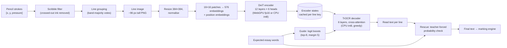
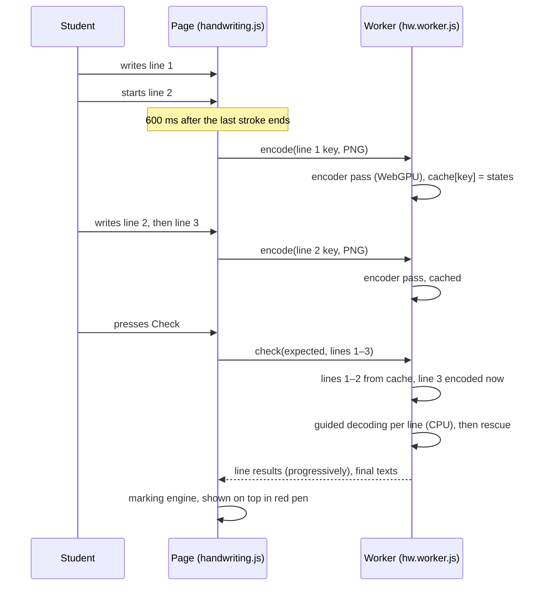

# RecallHSC handwriting AI (beta)

> **Status: experimental, iPad + Apple Pencil only, on the [beta site](https://timliniscool.github.io/recallhsc/beta/).** The code lives on the [`beta` branch](https://github.com/timliniscool/recallhsc/tree/beta). Files that exist only there are linked to that branch.

In the exam, HSC students write by hand. The beta lets them practise that way: they write each answer with Apple Pencil on lined paper, press **Check**, and the writing is read **on the iPad** and then marked by the same engine as typed answers ([ALGORITHMS.md §4](ALGORITHMS.md#4-fuzzy-marking-and-sequence-alignment)).

The system has three layers, and this document keeps them separate:

1. **The upstream model.** Microsoft's TrOCR-small handwritten model (Li et al., 2021), a pretrained vision encoder and text decoder.
2. **RecallHSC's fine-tuning.** The same architecture, trained further offline on extra handwriting, including real iPad lines. The weights change; the architecture does not.
3. **RecallHSC's inference logic.** Ink capture, line segmentation, background pre-encoding, guided decoding and probability-based rescue. This is custom code around the model and does not change its weights.

Main files:

- [`js/handwriting/handwriting.js`](https://github.com/timliniscool/recallhsc/blob/beta/js/handwriting/handwriting.js): the page side (capture, lines, images, user interface).
- [`js/handwriting/hw.worker.js`](https://github.com/timliniscool/recallhsc/blob/beta/js/handwriting/hw.worker.js): the model worker (inference, guidance, rescue).
- [`models/recallhsc-trocr/`](https://github.com/timliniscool/recallhsc/tree/beta/models/recallhsc-trocr): the model files.

## Contents

1. [The neural network](#1-the-neural-network)
2. [From Pencil to pixels](#2-from-pencil-to-pixels)
3. [Transformer inference](#3-transformer-inference)
4. [Context-aware guided decoding](#4-context-aware-guided-decoding)
5. [Probability-based rescue](#5-probability-based-rescue)
6. [Handwriting-specific fuzzy matching](#6-handwriting-specific-fuzzy-matching)
7. [On-device performance engineering](#7-on-device-performance-engineering)
8. [Training and improvement](#8-training-and-improvement)
9. [Recognition reliability](#9-recognition-reliability)

---

## 1. The neural network

### 1.1 Architecture

The architecture is TrOCR: a vision Transformer encoder (DeiT, Touvron et al., 2021) feeding an autoregressive Transformer text decoder through cross-attention (Vaswani et al., 2017). The values below come from [`config.json`](https://github.com/timliniscool/recallhsc/blob/beta/models/recallhsc-trocr/config.json) and [`preprocessor_config.json`](https://github.com/timliniscool/recallhsc/blob/beta/models/recallhsc-trocr/preprocessor_config.json):

| | Encoder (DeiT) | Decoder (TrOCR) |
|---|---|---|
| Layers | 12 | 6 |
| Hidden size | 384 | 256 (`d_model`) |
| Attention heads | 6 | 8 |
| Feed-forward size | 1536 (GELU) | 1024 (ReLU) |
| Input | 384 × 384 × 3 image, 16 × 16 patches, so **576 patches** | tokens; cross-attention reads the 384-dim encoder states |
| Positions | learned | learned, at most 512 |
| Vocabulary | none | **64,044** sentence-piece tokens (XLM-RoBERTa tokenizer) |

- **Special tokens:** `<s>` = 0, `<pad>` = 1, `</s>` = 2. Decoding starts from token 2.
- **Preprocessing:** resize to 384 × 384 (bicubic), rescale by 1/255, normalise with mean 0.5 and standard deviation 0.5 per channel.
- **Size:** Microsoft reports TrOCR-small at about 62 M parameters (Li et al., 2021). RecallHSC keeps that architecture unchanged.

### 1.2 Files, precision and runtime

The model is exported to ONNX (opset 17, with the `image-to-text-with-past` task) and served from the site itself, not from a third party:

| File | Size | Precision | Used for |
|---|---:|---|---|
| `encoder_model_fp16.onnx` | 44.0 MB | float16 | encoder on **WebGPU** |
| `encoder_model_quantized.onnx` | 23.1 MB | dynamic int8 (QUInt8 weights) | encoder on CPU (fallback) |
| `decoder_model_merged_quantized.onnx` | 40.3 MB | dynamic int8 | decoder, always on CPU |

The two decoder graphs (the first step, and later steps that use cached keys and values) are quantised separately and then merged into one file. Quantising the already-merged graph keeps a float copy of the shared weights and produces a file of about 159 MB.

A device downloads only one encoder: about 84 MB on the WebGPU path and about 63 MB on the CPU path, plus the 4.8 MB tokenizer.

Inference runs in a Web Worker using [Transformers.js](https://github.com/huggingface/transformers.js) **4.3.2** with **ONNX Runtime Web 1.30.0**. Both are bundled in the repository (`js/vendor/transformers/`) and not loaded from a CDN. They run single-threaded (`numThreads = 1`), because GitHub Pages cannot send the headers that cross-origin isolation (and so multi-threaded WebAssembly) would need.

**Versioning.** `MODEL_VERSION` in `handwriting.js` and `MODEL` in `sw.js` name the deployed model. It is currently `r4`, with cache `recallhsc-model-r4`. Changing the model means bumping both. The service worker then keeps the new model in its own cache that survives app updates, and deletes the old one. Every marking report and handwriting sample records which model read it (`app_version: "beta · reader r4"`).

A debug switch, `?m=xenova` on the worker URL, loads the original upstream weights for side-by-side comparison.

---

## 2. From Pencil to pixels

### 2.1 Capture

- **Pencil only.** Only `pointerType === 'pen'` events draw, so palms and fingers resting on the screen are ignored.
- **Every sample point.** Each `pointermove` contributes its coalesced events (`getCoalescedEvents()`), which keeps the full Pencil sampling rate even when the page renders slower.
- **Point format.** Each point is stored as `[x, y, pressure]` in CSS pixels relative to the canvas. Pressure defaults to 0.5 when the device reports none.
- **Rendering.** Each segment is drawn with width $(1.1 + 2.6\,\bar p)\cdot DPR$, where $\bar p$ is the mean pressure of its two ends, so harder pressure gives darker, thicker ink, as with a pen. $DPR$ is capped at 1.5 to keep canvas memory reasonable.
- **Staying aligned.** A `ResizeObserver` re-fits the canvas whenever its layout size changes. Each stroke also checks that the canvas's backing store matches its on-screen size before drawing, so ink always lands under the pencil tip.

**Editing tools.**

- *Eraser:* removes whole strokes. Any stroke that passes within 10 px of the eraser is removed in full. It toggles with a two-finger tap, because Safari does not expose the Pencil's double-tap to websites.
- *Undo and Clear.*
- *Red pen:* after marking, the pen turns into a thin red pen for annotating. Red strokes are **never read**.

### 2.2 Crossed-out writing

Students cross words out. If that ink were read, it would turn into nonsense words. `scribbled()` therefore looks for strokes that **zig-zag back and forth over their own width**. A stroke is a candidate if it has at least 20 points and, where $len$ is its path length and $w$ its bounding-box width (at least 12):

```math
len \ge 6w \quad\wedge\quad sweeps \ge 8
```

A *sweep* is a horizontal run, in one direction, longer than $0.3\,w$. A candidate is ignored, together with any other stroke that lies at least 70% inside its bounding box (the crossed-out word), if it covers other ink or is **obvious**:

```math
len \ge 12w \;\wedge\; sweeps \ge 14
```

Ordinary cursive covers about 3–4 times its width and rarely reverses direction 8 times, so real words are not mistaken for crossings-out. An end-to-end test checks a looping cursive word against exactly this.

### 2.3 Line segmentation

Strokes are grouped into lines before reading.

**Lined paper.** Each point votes for a ruled line using a "band-majority" rule. With rule spacing $R$ (48–58 px, depending on sheet width), a point at height $y$ votes for line $L$ when

```math
r_L - 0.8R \;\le\; y \;\le\; r_L + 0.12R,\qquad r_L = R_0 + (L+1)R
```

A stroke belongs to the line with the most votes. This keeps the descenders of *g, p, y* and the ascenders of *h, l, t* with their own word, rather than splitting by a stroke's centre point.

**Blank paper.** Strokes are sorted by vertical midpoint and grouped greedily. A stroke joins the current line when its midpoint is within $0.9\,h$ of the line's running mean, where $h$ is the median stroke height.

Each line gets a **key** built from its stroke ids and total point count. If anything about the line changes, its key changes too.

### 2.4 Line images

`lineImage()` crops the line's bounding box with 10 px padding, scales it to about **96 px tall** (upscaling is capped at 2×), and draws black ink on white with stroke width $(1.6 + 2.2\,\bar p)\cdot k$, where $k$ is the scale. It exports the result as a PNG. The model's processor then resizes it to 384 × 384 and normalises it (§1.1).

---

## 3. Transformer inference



**Encoder.** The image is cut into 576 patches of 16 × 16 pixels. Each patch is projected to a 384-dimensional embedding and given a learned position embedding. Twelve layers of multi-head self-attention (6 heads) let every patch attend to every other patch, so the representation of a stroke takes its neighbouring letters into account.

**Decoder.** It generates sentence-piece tokens one at a time. At each step it attends to the tokens produced so far (masked self-attention) and to all 576 encoder states (cross-attention), and produces logits over the 64,044-token vocabulary. RecallHSC decodes greedily, takes the most likely token at each step, and stops at `</s>` or after 48 new tokens per line.

**Why the work is split.** The encoder runs once per line and is one large, parallel computation, which suits the GPU. The decoder runs one tiny step per token. On a phone or tablet, a GPU round trip per token costs more than simply computing the step on the CPU. So the worker puts the **encoder on WebGPU (fp16)** and the **decoder on WebAssembly (int8)**. If WebGPU is missing, or fails to load the model, the whole model falls back to WebAssembly.

---

## 4. Context-aware guided decoding

RecallHSC knows what the student is *trying* to write: the expected essay text. Ignoring that would waste information. Using it carelessly would turn the recogniser into a machine that rubber-stamps the answer. The `Guide` class (a Transformers.js `LogitsProcessor`) takes a cautious middle path.

### 4.1 Where in the expected text is the student?

The guide keeps a pointer $j$ into the expected words. Each new line starts from the position where the previous line ended. That position is chosen by `advance()`, which picks the number of expected words $k$ that best explains the words read so far:

```math
k^* = \arg\max_k \Big(\text{LCS}(E[ptr..ptr{+}k),\ \text{read}) - 0.35\,\big|k - |\text{read}|\big|\Big)
```

where LCS is the length of the longest common subsequence. Within a line, every completed word read so far moves the pointer on by one, or by two if the word matches the expected word after next. That allows for one skipped word.

### 4.2 Which tokens get a boost

The expected word at the pointer is tokenised. A line's first word is tokenised without a leading space; later words with one.

- **Mid-word:** if the tokens generated so far already match the start of the expected word, only the **next piece** of that word is a candidate.
- **At a word boundary:** the candidates are the first token of the expected word $j$ (the **primary**) and the first token of word $j+1$ (the **secondary**, in case the student skipped a word).

### 4.3 The boost, and its safeguards

Let $z_t$ be the logit of candidate token $t$ and $z_{\max}$ the largest logit at this step. The boost applies only if the model **already considers the token plausible**:

```math
z_t \ge z_{\max} - 5 \quad\text{and}\quad \big|\{v : z_v > z_t\}\big| < 8
```

That is, the token is within 5 logits of the top and already in the top 8. Then

```math
z_t \leftarrow z_t + \begin{cases} 4 & \text{primary} \\ 2 & \text{secondary} \end{cases}
```

A logit boost of $\Delta$ multiplies that token's odds against every other token by $e^{\Delta}$: $e^4 \approx 54.6$ and $e^2 \approx 7.4$.

**Numerical example.** Suppose the model's top candidate for the next word is *Great* with $z = 12.0$, and the expected *Getae* has $z = 10.0$. Before the boost, *Getae* is $e^{-2} \approx 0.14$ times as likely as *Great*. It is within the margin (2 < 5) and ranked second, so it gets +4: now $z = 14.0$, and it is $e^{2} \approx 7.4$ times as likely as *Great*. Greedy decoding picks *Getae*.

If instead the student wrote a different word and *Getae* sat at $z = 6.5$, which is 5.5 below the top, **no boost happens** and the reader writes what it sees.

**Safeguards against simply substituting the answer:**

- nothing is ever *forced* or *masked*;
- at most two tokens per step can be boosted, by a bounded amount;
- only tokens the model already ranks highly qualify;
- once the expected words run out, guidance stops.

A word the student clearly wrote differently scores far outside the top 8 and is read as written. Marking then catches it.

---

## 5. Probability-based rescue

Guidance only helps tokens near the top of the list. A messy word can still be misread entirely. After reading, `check()` aligns the read words against the expected words ([§6](#6-handwriting-specific-fuzzy-matching) explains the alignment) and looks at each run of mismatches on a line. It asks one question: **does the ink fit the expected words?**

### 5.1 Teacher-forced scoring

`fit(v, before, words)` runs the decoder once over a fixed sequence (teacher forcing): the start token, then the line's words before the mismatch (as context), then the candidate words. From a single forward pass it takes the log-probability of each candidate token given the image and everything before it:

```math
\ell_k = \log P\big(y_k \mid y_{<k},\ \text{image}\big) = z_{y_k} - \log\sum_v e^{z_v}
```

This is computed with the usual max-subtraction for numerical stability. The **compatibility score** is the geometric-mean token probability over the $K$ candidate tokens:

```math
f = \exp\!\Big(\tfrac{1}{K}\textstyle\sum_{k=1}^{K} \ell_k\Big)
```

$f$ measures how well a word sequence explains this image under the model. **It is not a calibrated confidence**, and it should not be read as "the probability that the student wrote this".

### 5.2 Acceptance rules

Let $f$ be the score of the *expected* words, $f_s$ the score of what the reader *saw*, and $sim$ the letter-level similarity of the two (§6). The expected words replace the misread ones if

```math
f \ge 0.03 \;\;\lor\;\; \big(f \ge 0.001 \wedge sim(\text{seen}, \text{expected}) \ge 0.58\big) \;\;\lor\;\; \ln f \ge \ln f_s - 2.5
```

If the reader dropped or merged words entirely (there is nothing seen to compare with), the rule is $f \ge 0.05$.

- **The absolute thresholds.** According to the source comments, a genuinely different word typically scores around $10^{-4}$, well below 0.03.
- **The lookalike rule.** It accepts a weaker fit (0.001) only when the misreading also *looks* like the expected word, so both the neural evidence and the letter shapes must agree.
- **The relative rule.** It compares the two hypotheses under the same model. The expected words are accepted if they are at most $e^{2.5} \approx 12$ times less probable per token than the reader's own guess.

Each run costs one or two extra decoder passes. The encoder is not re-run.

### 5.3 Worked example (illustrative numbers)

The student wrote *Getae* and the reader produced *Great*. Suppose the decoder assigns the three tokens of " Getae" probabilities 0.20, 0.05 and 0.40 given the image and the line so far:

```math
f = (0.20 \times 0.05 \times 0.40)^{1/3} = 0.004^{1/3} \approx 0.159 \ge 0.03 \;\Rightarrow\; \text{accept}
```

If the student had actually written *Romans*, the expected tokens might score something like 0.001, 0.0002 and 0.0005, giving $f \approx 4.6\times10^{-4}$. That fails the absolute rule. $sim(\text{Romans}, \text{Getae})$ is low, so the lookalike rule fails too. And *Romans* itself would fit far better, so the relative rule fails as well. The misreading stands, and marking reports a wrong word.

These figures illustrate the arithmetic. They are not measurements.

---

## 6. Handwriting-specific fuzzy matching

Ordinary Levenshtein distance treats every substitution alike. In handwriting, though, *l*, *i* and *1* are easily confused, while *l* and *w* are not. `similar(a, b)` is a **weighted edit distance**:

- insertions and deletions cost 1;
- a substitution costs 0.3 if both characters are in the same **confusion group**, otherwise 1;
- before comparing, `)` and `|` are mapped to `l` and only `[a-z0-9+]` is kept.

The confusion groups are:

```text
l i 1 j t f | a o u e c | n m r h u | e c | s 5 z | g q y 9 | b h 6 k | d a cl | v u y
w vv uu | m rn nn | u ii n v | h li b n | o 0 a c | t f l + | k h x | p q b | z 2 s
```

It also allows **one-to-two-character confusions**. The recurrence has two extra moves:

```math
D_{i,j} = \min\Big(D_{i-1,j}+1,\ D_{i,j-1}+1,\ D_{i-1,j-1}+c(a_i,b_j),\ D_{i-2,j-1}+c(a_{i-1}a_i,\ b_j),\ D_{i-1,j-2}+c(a_i,\ b_{j-1}b_j)\Big)
```

so *rn* ↔ *m*, *cl* ↔ *d* and *vv* ↔ *w* each cost 0.3. The similarity is

```math
sim(a,b) = 1 - \frac{D_{|a|,|b|}}{\max(|a|,|b|)}
```

and the lookalike rule in §5 requires $sim \ge 0.58$.

**The two kinds of evidence work together.** The neural score $f$ says whether the expected words *could* have produced this ink. The visual similarity says whether the misreading *looks like* those words. A low-probability rescue (0.001 ≤ $f$ < 0.03) is accepted only when both agree.

---

## 7. On-device performance engineering

Reading a whole page in one go after **Check** would feel slow on an iPad. So RecallHSC moves work earlier, into the moments while the student is still writing.



- **Background pre-encoding.** 600 ms after a stroke ends, every *finished* line is rendered and sent to be encoded. The line holding the most recent stroke is skipped, because it may not be finished. Lines already sent are skipped too. This is not live recognition: only the encoder runs, and the text appears only after Check.
- **The encoder cache** is an LRU map from line key to encoder output, capped at **40** lines. Changing a line changes its key, so stale encodings can never be reused. No explicit invalidation is needed.
- **A single job queue** runs everything in order (one model, one job at a time), so background encodes and a Check never compete for the model.
- **Hardware strategy.** The encoder runs on WebGPU in fp16 when available, otherwise on CPU in int8. The decoder always runs on CPU in int8.
- **Persistent model cache.** The service worker caches the model files in their own versioned cache (`recallhsc-model-r4`), so the roughly 100 MB download happens once per model version. It is not repeated on every app update.
- **Worker isolation.** All inference happens off the main thread, so writing and scrolling stay smooth.

The worker reports its timings (`ms`, plus `perf {enc, read, fit, fits}`), and the page shows "Read in X.Xs". This document quotes no speed figures, because they depend heavily on the iPad model.

---

## 8. Training and improvement

The upstream model was trained on scanned and printed handwriting. iPad ink looks different: uniform thin strokes, digital anti-aliasing, unusually wide word spacing, and essay vocabulary full of acronyms and quotations such as "(LTQ)". RecallHSC fine-tuned the model **offline**, in a separate training environment. Each round's settings and scores come from its training log.

**Data.**

- [IAM-line](https://huggingface.co/datasets/Teklia/IAM-line) (Marti & Bunke, 2002): 6,482 training lines.
- [ClozeFormHandwriting](https://github.com/Shrey0900/ClozeFormHandwriting): 2,160 lines.
- SMHD-forms: 2,953 lines cut from scanned pages.
- About 9,400 synthetic lines drawn in handwriting-style fonts with per-word jitter, written in HSC essay style (acronyms, quotations, names).
- **Real iPad lines from the beta.** Each one was checked and labelled by hand: 157 lines for round 3 and 279 for round 4.

**Augmentation.**

- *ipadify* turns scanned lines into iPad-like ink: binarise, crop to the ink, vary the pen weight, rescale to the app's 96 px line height, and add slant.
- *realaug* applies light jitter to the real iPad lines.

**Rounds.**

| Round | Starting point | Training data | Model version |
|---|---|---|---|
| 1 | Microsoft TrOCR-small handwritten | IAM, ClozeForm, SMHD + iPad-style augmentation | first fine-tuned release |
| 2 | round 1 | + synthetic essay-style lines | r2 |
| 3 | round 2 | 157 hand-labelled real iPad lines (repeated 25×) mixed with 12,000 general lines | r3 |
| 4 | round 2 (same recipe as round 3) | 279 hand-labelled real iPad lines, including a new passage | **r4 (current)** |

**Results from the training logs.** These numbers come from small evaluation sets drawn from a single writer, so read them as indications, not benchmarks:

- *Round 1*, general iPad-style validation: character error rate 8.6% → 7.0%.
- *Round 3*, real iPad lines from passages it never saw in training: word errors (counted as the app marks them) 16.7% → 11.1%, measured on only 15 lines.
- *Round 3*, general iPad-style handwriting: about unchanged (6.7% → 7.1% CER).
- *Round 4*, a passage no model had seen in training (41 lines): marked-word errors 20.6% (round 3) → 18.0% (round 4 recipe). General iPad-style CER 7.0%.
- **Rejected:** 1,412 lines recovered from sideways-scanned SMHD pages, which did not improve results.

**Sample collection (implemented).** On the beta, students who are **signed in** may contribute their handwriting:

- **What is sent:** line images (PNG), the expected text, what the reader read, the final answer, whether it passed, and the model version.
- **Controls:** on by default for signed-in beta users, with a switch in Settings; capped at 120 samples per device per day.
- **Storage:** an insert-only Supabase table that no client can read back.
- **Reports:** a student can also report a wrong marking ("misread"), which sends the same data.

**What is *not* implemented.** The model does **not** learn on the device and does **not** adapt continuously to any individual student. Collected samples are reviewed and used, by hand, in later offline training rounds. Each round is then deployed as a new, versioned model for everyone.

---

## 9. Recognition reliability

The central difficulty is telling apart two very different events:

- **a memory error:** the student wrote the wrong word, so marking *should* fail;
- **a recognition error:** the student wrote the right word but the reader misread it, so marking should *not* fail.

Both look the same to the marker: the read text differs from the expected text. Using the expected text helps with recognition, but brings **expected-answer bias**:

- **False acceptance:** a wrong word gets "rescued" into the right one, and the student never learns they made a mistake.
- **False rejection:** a right word stays misread, and the student is wrongly marked down.

Measures that limit false acceptance:

- Guidance only boosts tokens already in the model's top 8 and within 5 logits of the top. It never forces anything.
- Rescue needs real evidence from the image: $f \ge 0.03$; or a weaker fit together with visual similarity of at least 0.58; or a probability no worse than about 12× the reader's own hypothesis.
- Marking itself remains strict: missing words and extra words still count.

Measures that limit false rejection:

- Fine-tuning on iPad-style and real iPad ink.
- The rescue step, the lookalike confusion groups, and standard-mode spelling tolerance.

Measures that keep the student in control:

- Lines that do not match are highlighted.
- The red pen lets the student annotate their work.
- **Report marking → "Misread"** sends the case, with its images, for review.

No overall accuracy figure for marking is claimed here. The figures in §8 come from small, single-writer test sets and are only indicative.

## References

- M. Li, T. Lv, J. Chen, et al. (2021). *TrOCR: Transformer-based Optical Character Recognition with Pre-trained Models.* arXiv:2109.10282 ([model](https://huggingface.co/microsoft/trocr-small-handwritten)).
- H. Touvron, M. Cord, M. Douze, et al. (2021). *Training data-efficient image transformers & distillation through attention (DeiT).* ICML.
- A. Vaswani, N. Shazeer, N. Parmar, et al. (2017). *Attention Is All You Need.* NeurIPS.
- U.-V. Marti, H. Bunke (2002). *The IAM-database: an English sentence database for offline handwriting recognition.* IJDAR 5.
- [Transformers.js](https://github.com/huggingface/transformers.js), [ONNX Runtime Web](https://onnxruntime.ai/), [Xenova/trocr-small-handwritten](https://huggingface.co/Xenova/trocr-small-handwritten) (ONNX conversion and tokenizer files).
